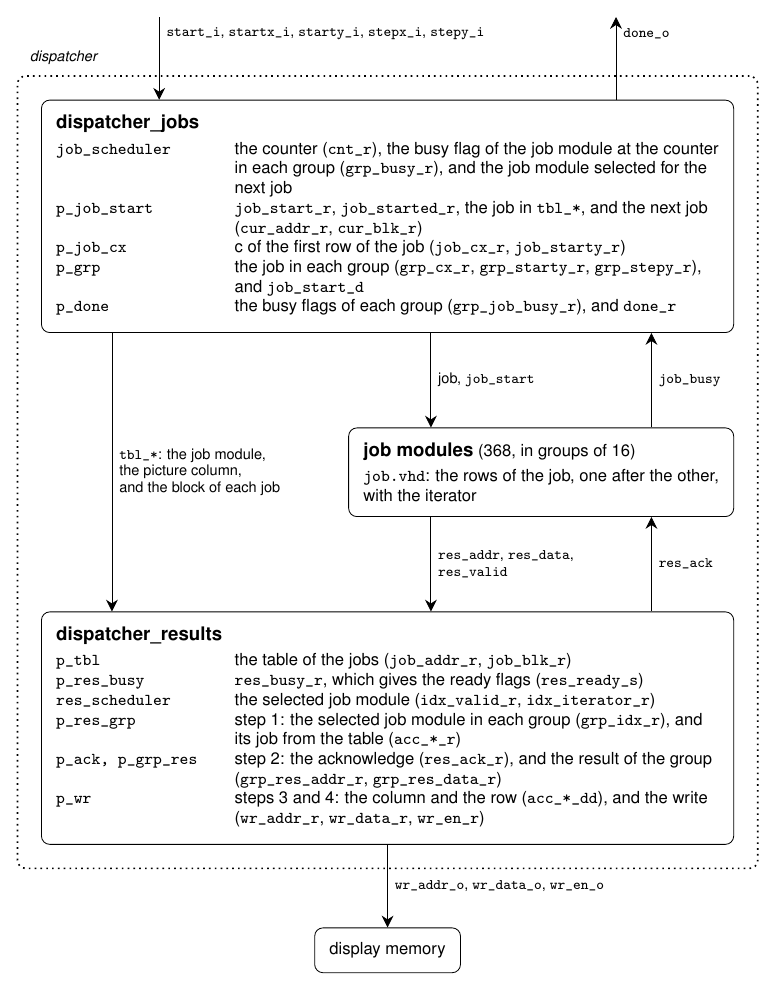
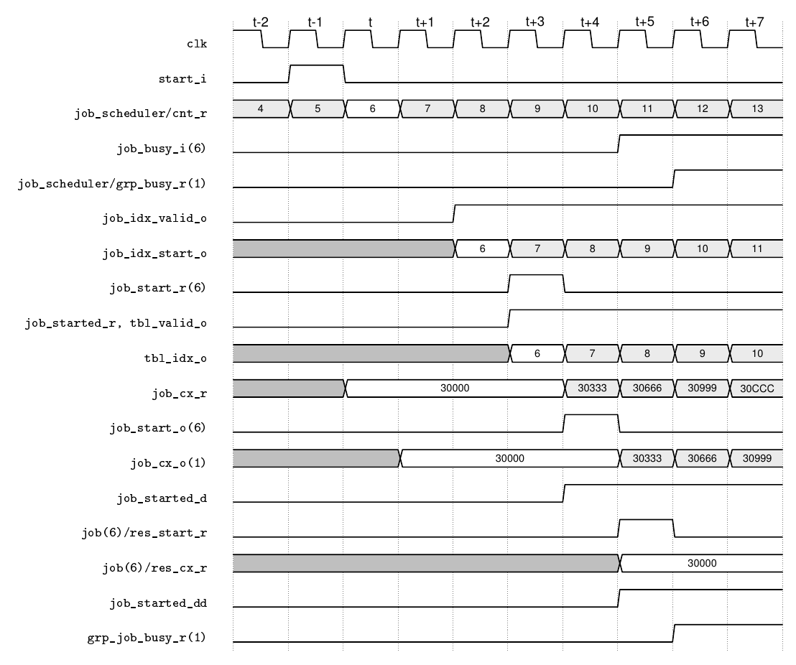
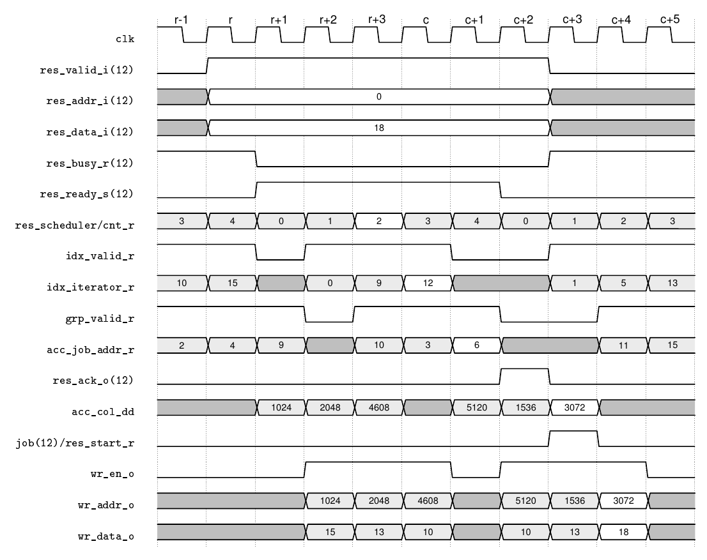

# The algorithm and its implementation
## Contents
* [Introduction](#introduction)
* [Terms](#terms)
* [Instantiation hierarchy](#instantiation-hierarchy)
* [The Mandelbrot iteration](#the-mandelbrot-iteration)
* [Fixed point arithmetic](#fixed-point-arithmetic)
* [Multiplier](#multiplier)
* [Iterator](#iterator)
  * [Periodicity detection](#periodicity-detection)
  * [Overflow](#overflow)
* [Jobs](#jobs)
* [Dispatcher](#dispatcher)
  * [Timing of a job and a result](#timing-of-a-job-and-a-result)
* [The top level](#the-top-level)
* [Display memory](#display-memory)
* [Redraw](#redraw)
* [View control](#view-control)
* [Frame rate](#frame-rate)
* [Overlay](#overlay)
* [Colours](#colours)
* [Timing](#timing)
* [Resources and timing closure](#resources-and-timing-closure)
  * [MEGA65](#mega65)
  * [Nexys 4 DDR](#nexys-4-ddr)
  * [Power](#power)

The history of the design, i.e. the earlier versions of its parts and the
results of the earlier builds, is in [HISTORY.md](HISTORY.md).

## Introduction
This describes in some detail how the Mandelbrot design works, and the main
parts it is built from. See [README.md](README.md) for an overview, a list of
files, and how to build and run the design.

The design is implemented on the MEGA65 (board revisions R3 and R6), which
uses a Xilinx FPGA XC7A200T. This FPGA has a total of 740 DSPs, of which 736
are used for the actual calculations. Additionally, the FPGA contains 365
BRAMs (of 36 kbit each), of which 320 are used for storing the results of the
calculation, i.e. the actual picture to be displayed (1280x1024). The same
design also runs on the Nexys 4 DDR board, with a smaller FPGA (XC7A100T, with
240 DSPs and 135 BRAMs) and a resolution of 640x480, see
[Nexys 4 DDR](#nexys-4-ddr). The numbers in this document are for the MEGA65,
unless stated otherwise.

The design was first developed on the Nexys 4 DDR, and the MEGA65 was added
later. This document describes the current design. How it got there, i.e.
the earlier versions of its parts, the numbers of the model at the time, and
the results of the earlier builds, is in [HISTORY.md](HISTORY.md), which is
mostly about the Nexys 4 DDR, at 640x480.

## Terms
The following terms are used in this document:
* A *picture column* is a vertical slice of the picture.
* A *job* is 64 rows of a picture column, i.e. a sixteenth of it. The picture
  is divided into 16 *blocks* of 64 rows, so there are 20480 jobs. On the
  Nexys 4 DDR a job is 120 rows (a quarter of a picture column), and there
  are four blocks and 2560 jobs.
* The display memory is divided into blocks too, of one BRAM each (see
  [Display memory](#display-memory)). Which kind of block is meant is clear from
  the context: the display memory, or the jobs.
* A *group* is a group of 16 job modules in the dispatcher, or of 8 blocks in
  the display memory, which share a register for the signals that go to all
  of them, so that each route is shorter.
* A *job module* is an instance of [`src/main/job.vhd`](src/main/job.vhd). It
  calculates one job at a time, row by row, using one iterator.
* An *iterator* is the block in [`src/main/iterator.vhd`](src/main/iterator.vhd). It
  calculates the count for a single point.

## Instantiation hierarchy
The modules are instantiated as follows on the MEGA65:
```
mega65_r6 (or mega65_r3)                src/mega65_r6.vhd, src/mega65_r3.vhd (top level, the pins of each board revision)
 +- max10                               src/max10/max10.vhd (only on the R3: reads the reset button from the MAX10)
 +- mega65                              src/mega65.vhd (the design for the MEGA65)
     +- m2m_keyb                        src/keyboard/m2m_keyb.vhd (keyboard driver, in the MAIN clock domain)
     +- controls                        src/main/controls.vhd (maps the joysticks and keys to the buttons and switches)
     +- clk_rst                         src/clk_rst.vhd (MMCM, clock buffers, and resets)
     +- core                            src/core.vhd (the part that is the same on all the boards, without Xilinx primitives)
         +- main                        src/main/main.vhd (everything in the MAIN clock domain)
         |   +- viewport                src/main/viewport.vhd (view control from the buttons; state machine, types in src/main/viewport_pkg.vhd)
         |   |   +- viewport_axis (x 2) src/main/viewport_axis.vhd (the view along one axis, one for x and one for y)
         |   +- dispatcher              src/main/dispatcher.vhd (types in src/main/dispatcher_pkg.vhd)
         |   |   +- dispatcher_jobs     src/main/dispatcher_jobs.vhd (gives out the jobs, and the done flag)
         |   |   |   +- job_scheduler   src/main/job_scheduler.vhd (selects the job module to receive a job)
         |   |   +- job     (x 368)     src/main/job.vhd (the job modules)
         |   |   |   +- iterator        src/main/iterator.vhd
         |   |   |       +- (DSP48E1)   (x 2, inferred in p_dsp, multiplier and adder)
         |   |   +- dispatcher_results  src/main/dispatcher_results.vhd (collects the results and writes them)
         |   |       +- res_scheduler   src/main/res_scheduler.vhd (selects the job module whose result is accepted)
         |   +- fps                     src/main/fps.vhd (frame rate, calculated from the time for a picture)
         |   +- view_text               src/main/view_text.vhd (the view as text: the centre and the zoom)
         |   +- seg                     src/main/seg.vhd (7-segment display, not used on the MEGA65)
         +- disp_mem                    src/disp_mem.vhd (display memory, between the two clock domains)
         |   +- disp_blk                src/disp_blk.vhd (one block of the display memory, a BRAM)
         +- cdc_data                    src/cdc_data.vhd (moves the frame rate and the view to the VGA clock domain)
         +- vga                         src/vga/vga.vhd (everything in the VGA clock domain)
         |   +- pix                     src/vga/pix.vhd (pixel counters, for the video mode in src/vga/video_pkg.vhd)
         |   +- disp                    src/vga/disp.vhd (VGA output, uses the palettes in src/vga/palette_pkg.vhd)
         |   +- overlay                 src/vga/overlay.vhd (the view and the frame rate, uses the font in src/vga/font_pkg.vhd)
     +- (p_vdac, i_vdac_clk)            (outputs to the video DAC, for the VGA connector)
     +- vga_to_hdmi                     src/hdmi/vga_to_hdmi.vhd (encodes the picture to TMDS symbols, in DVI mode)
     +- serialiser_10to1_selectio       src/hdmi/serialiser_10to1_selectio.vhd (x 4, the HDMI data and clock)
```
On the Nexys 4 DDR, the top level is `nexys4ddr` (`src/nexys4ddr.vhd`), which
instantiates `clk_rst` and `core` in the same way as `mega65` does, but has no
keyboard, video DAC, or HDMI output, and drives the 7-segment display from
`seg`.

The number of job modules (and therefore iterators, with two DSPs each) is
set by the generic `G_NUM_ITERATORS` of `main`, which the design sets to 368
on the MEGA65 (see `src/mega65.vhd`), and to 120 on the Nexys 4 DDR (see
`src/nexys4ddr.vhd`).

## The Mandelbrot iteration
For each point $c = c_x + i c_y$ in the picture, we iterate
$z_{n+1} = z_n^2 + c$, starting from $z_0 = 0$. The number of iterations needed
before the real or the imaginary part of $z$ is outside the range -2 to 2 (or a
maximum iteration count is reached) is used to colour the pixel, see
[Overflow](#overflow).

The usual test is whether $|z|$ is larger than 2. If the real or the imaginary
part is outside the range -2 to 2, then $|z|$ is at least 2, so the test used
here detects the points outside the Mandelbrot set too, only sometimes a few
iterations later (the count differs by at most 2 for the initial view). The
points that are shown as inside the set are the same with both tests, except
for points where $|z|$ becomes exactly 2, such as $c = -2$ (see
[Overflow](#overflow)), and for the few points where $|z|$ only becomes
larger than 2 just before the maximum count, so the test used here reaches
the maximum count first (2 pixels of the initial view).

Writing $z = x + iy$, the iteration is
```
new_x = x*x - y*y + cx
new_y = 2*x*y + cy
```
This can be rewritten to use only two (real) multiplications:
```
new_x = (x+y)*(x-y) + cx
new_y = 2*(x*y) + cy
```

## Fixed point arithmetic
Numbers are represented as "fixed point binary two's complement". Specifically,
2.16 bit representation is used, i.e. two bits for the integer portion, and 16
bits for the fraction part.

This means we can represent real numbers in the range -2 .. 2, with an accuracy
of 0.5^16, i.e. about 5 decimal places of accuracy. A real number x is
represented using the binary number of x\*2^16, if x is positive, and
(x+4)\*2^16 if x is negative.

The first bit acts as a sign bit. It is '1' if the number is negative, and it
is '0' if the number is positive.

Some examples are:
```
-2        : 10.0000000000000000 = 0x20000
-1.5      : 10.1000000000000000 = 0x28000
-1        : 11.0000000000000000 = 0x30000
-0.000015 : 11.1111111111111111 = 0x3FFFF
 0        : 00.0000000000000000 = 0x00000
 0.000015 : 00.0000000000000001 = 0x00001
 0.5      : 00.1000000000000000 = 0x08000
 1        : 01.0000000000000000 = 0x10000
 1.5      : 01.1000000000000000 = 0x18000
```

## Multiplier
The built-in DSP (DSP48E1) provides a 25x18-bit signed multiplier, followed by
a 48-bit adder (the post-adder). Each iterator uses two of them, one for each
of the two multiplications of an iteration:
* The first DSP is used as a 19x18-bit multiplier, with the first input
  (x+y or x-y) in 3.16 bit representation and the second input (the other
  one) in 2.16 bit representation (see [Overflow](#overflow) for why the
  first input has 19 bits). The post-adder adds cx, so the output is the new
  value of x.
* The second DSP is used as an 18x18-bit multiplier, with the inputs x and y.
  The post-adder adds cy/2, so the output is half the new value of y.

The products are always between -4 and 4, and the sums between -6 and 6, so
they fit in 4.32 bit representation (36 bits), which is the lowest 36 bits of
the 48-bit output of the DSP.

The output of each DSP is registered in the DSP (the register P), and these
two registers *are* the values of x and y of the iterator: the inputs of the
multipliers are not registered, and neither are the products (the registers
A, B, and M are not used), so the DSPs calculate a complete iteration in each
clock cycle. The constants cx and cy/2 are registered (the register C), which
does not delay anything, because they do not change while a point is
calculated.

The DSPs are not instantiated directly. They are inferred by Vivado from the
process `p_dsp` in [`src/main/iterator.vhd`](src/main/iterator.vhd), so the
simulation needs no model of the DSP. The "DSP Final Report" in `build/<board>/vivado.log`
shows how the DSPs are used (`(C'+A*B)'`, i.e. the registers C and P).

## Iterator
This component ([`src/main/iterator.vhd`](src/main/iterator.vhd)) performs the main
calculation. It takes as input the complex number c (or rather the real and
imaginary values cx and cy). It then iterates the Mandelbrot function a number
of times and stops when either the maximum iteration count is reached, or an
overflow occurs.

The inputs to this block are: start\_i, cx\_i, and cy\_i. Outputs are done\_o
and cnt\_o. The values of cx\_i and cy\_i must be held constant for the entire
calculation. The signal start\_i is pulsed high for a single clock cycle. The
signal done\_o goes high when the calculation is finished, and stays high, with
cnt\_o unchanged, until the next start\_i.

Example: We start with the point -0.5+0.5i, i.e. cx = -0.5 and cy = 0.5. This
point is in the Mandelbrot set, so the iteration continues until the maximum
count. The expected sequence of points is then:
```
cnt |   x                |   y
----+--------------------+--------------------
 0  |  0.00000 (00000)   |  0.00000 (00000)
 1  | -0.50000 (38000)   |  0.50000 (08000)
 2  | -0.50000 (38000)   |  0.00000 (00000)
 3  | -0.25000 (3C000)   |  0.50000 (08000)
 4  | -0.68750 (35000)   |  0.25000 (04000)
 5  | -0.08984 (3E900)   |  0.15625 (02800)
 6  | -0.51634 (37BD1)   |  0.47192 (078D0)
 7  | -0.45612 (38B3C)   |  0.01265 (0033D)
 8  | -0.29213 (3B537)   |  0.48845 (07D0B)
```
The values in the parentheses are the (2.16 fixed point) hexadecimal
representation of the values, and the decimal numbers are these values rounded
to five decimals. The values are calculated with the bit-accurate model (see
below). Up to iteration 5 they are exact, but from iteration 6 the new values need
more than 16 fraction bits, and the iterator truncates them (rounds towards
minus infinity). So the values differ slightly from a calculation with real
numbers, e.g. x is -0.45610 in iteration 7 with real numbers.

The testbench for the iterator ([`sim/iterator_tb.vhd`](sim/iterator_tb.vhd))
is self-checking. It runs a few starting values (in the set, escaping
immediately, escaping quickly, and escaping slowly), and compares the count
with one calculated using real (floating point) numbers. The counts must be
equal, within a small tolerance. For the points in the set it also checks that
the periodicity detection stops the iteration long before the maximum count.
Then it compares the count exactly with the bit-accurate model (see below) for
a grid of 40 x 30 points over the initial view, and for six points that were
found by a search with the model, where x or y alone repeats a saved value
before the point escapes. These fail if the detection compares only x or only
y. It also checks that the registers P do not change while the iterator is
idle (see below), also after a point in a cycle of period 2 and after a point
that escapes, where they would otherwise go on changing. The script
[`sim/iterator_model.py`](sim/iterator_model.py) is a bit-accurate Python model
of the iterator, which follows the VHDL literally. It gives the same counts as
the testbench for the same points, and can be used to compare the iterator with
the real-number count for many more points (`./iterator_model.py --grid`).

The testbench includes two points where x+y or x-y is outside the range -2 to 2
during the iteration (see [Overflow](#overflow)).

The same bit-accurate model is also written in VHDL, in the package
[`sim/iterator_model_pkg.vhd`](sim/iterator_model_pkg.vhd). The testbenches for
the job module and the dispatcher compare every count with this model, and
require them to be equal. The iterator testbench still compares with real
numbers, so that it also checks that the model (i.e. the design) calculates the
Mandelbrot iteration.

The complete picture can be checked bit-accurately too. The script
[`sim/model.py`](sim/model.py) is a vectorized (numpy) version of the same
model, which calculates the count for every pixel of the initial view, using
the same values of c as the design. Run as a script, it compares the model with
a calculation using real numbers. The testbench
[`sim/main_tb.vhd`](sim/main_tb.vhd) runs `main.vhd` with the initial view, and
writes every pixel written to the display memory to the file
`sim/main_out.txt`. The script [`sim/cmp_rtl.py`](sim/cmp_rtl.py) then compares
these values with the model. The first line of the file is the size of the
picture and the address distance between two picture columns, so the script
knows the view and how to decode the addresses. By default the testbench
simulates the design of the MEGA65 (368 job modules, four pixels in each
write, jobs of 64 rows, 1280x1024 with 21 bits of address). Its generics
select the smaller design of the Nexys 4 DDR (120 job modules, four pixels
in each write, 640x480) with
`GENERICS="G_NUM_ITERATORS=120 G_PIXELS=4 G_ROWS_IN_JOB=120 G_NUM_COLS=640 G_NUM_ROWS=480 G_COL_STRIDE=512 G_ADDR_BITS=19"`,
see the Makefile. A complete picture takes a long time to simulate (about
40 minutes for the Nexys 4 DDR, i.e. 1.44 ms of simulated time), but a
partial picture can be compared too:
```
make run TB=main STOP_TIME=200us
sim/cmp_rtl.py
```
The 200 us of simulated time gives about 79000 pixels on the MEGA65 (about
14 minutes, see [MEGA65](#mega65)), and about 50000 pixels, from all 120 job
modules, on the Nexys 4 DDR (about 5 minutes). With `make check TB=main` it
also writes a waveform file (about 370 MB for the Nexys 4 DDR). This
testbench is not part of `make sim`.

The testbench [`sim/picture_tb.vhd`](sim/picture_tb.vhd) does the same
check inside the testbench, with the VHDL model, for a small picture (64x48,
with 8 job modules, four pixels in each write, and jobs of 12 rows), so it is
part of `make sim`. It checks every pixel of three pictures (the initial
view, then the view after zooming in and panning, and then after zooming
out): each pixel is written exactly once, the picture is complete when the
frame rate is updated, and the count of each pixel is the count of the
model. The view of each picture is read from `main` with external names.

The testbench [`sim/core_tb.vhd`](sim/core_tb.vhd) checks the whole design
from the buttons and switches to the VGA output, i.e. `core` with the clocks
of the Nexys 4 DDR (in the same ratio, 120 MHz and 25 MHz, but about 17 times
faster). A picture of a real size is too slow to simulate (the first picture
is the initial view, which is mostly inside the set), so the video mode is
560x4 (560 is the smallest width that `vga` accepts, because of the overlay),
with short blanking. For two pictures (the initial view with palette 1, and
the view after pan right held down for one update, with palette 3) it waits
until the picture is complete, and then checks the colour of every pixel of
the next frame of the VGA output against the model and the palette. It also
checks that the frame rate and the view in the VGA clock domain are those of
the MAIN clock domain, after `cdc_data`. The palette does not move in this
testbench (that is checked by `disp_tb`). It takes about 4 minutes, and is
part of `make sim`.

The board constants in `sim/model.py` and the defaults of the generics of
`sim/main_tb.vhd` are copies of those in `src/mega65.vhd` (and the model also
has those of `src/nexys4ddr.vhd`). `make consts` runs
[`sim/check_consts.py`](sim/check_consts.py), which reads the constants
from the VHDL files and checks that the copies are the same.

The iterator calculates one iteration in each clock cycle, using two DSPs
(see [Multiplier](#multiplier)). The registers P of the two DSPs hold x and
y (the first one x, the second one y/2, both in 4.32 bit representation), and
in each clock cycle:
* x+y and x-y are calculated (in 19 bits) from the outputs of the DSPs, in
  the FPGA fabric (see [Overflow](#overflow)),
* the first DSP multiplies them and adds cx, which gives the new value of x,
* the second DSP multiplies x and y and adds cy/2, which gives half the new
  value of y,

and the new values are registered in the registers P. At the start of a point
the registers P are cleared (with the synchronous reset of the DSP), i.e.
x = y = 0, so a point that stops after n iterations takes n+1 clock cycles
from the start until done\_o is high. In each clock cycle the iterator also
checks the overflow and the periodicity of the values in the registers P (see
below), and stops when one of them is found, or after the maximum count.

After that, the registers P keep their value until the next start: their
clock enable (CEP) is the busy flag of the iterator (`busy_r`). So nothing in
the iterator toggles while it is idle, i.e. between the jobs and when no
picture is calculated (see [Redraw](#redraw)). The clock enable is a
separate input of the DSP, so it is not in the longest path (below), and the
synchronous reset of the DSP (RSTP, the start) has priority over it, as in
the VHDL, so it needs no logic: the iterator still has 70 LUTs and 47
registers.

The path from the registers P, through the adder for x+y or x-y, the
multiplier, and the post-adder of the first DSP, and back to its register P,
is the longest path of the iterator, and it decides the clock frequency of
the whole design. About half of it is in the DSP (from its input to its
register P), and the rest is the adder and the routes from and to the DSPs.
So the two DSPs of an iterator must be next to each other, in the same
column: when the placer put them in different columns, the routes took up to
1.8 ns more. The build script (`mandelbrot.tcl`) puts each pair in a
relatively placed macro (`create_macro` and `update_macro`), which places the
two DSPs in adjacent sites.

Registering the inputs of the multipliers or the products (in the registers
A, B, or M of the DSP) would make the path much shorter, but each register
would add a clock cycle to each iteration. Two or three points could then be
calculated in turns by the same DSPs, but the job module would have to handle
several rows at the same time.

On both boards the number of job modules is limited by the number of DSPs,
see [Resources and timing closure](#resources-and-timing-closure). An earlier
version of the iterator used a single DSP, see
[HISTORY.md](HISTORY.md#the-iterator).

### Periodicity detection
Points in the Mandelbrot set never overflow, so they would take the maximum
number of iterations (511). For the initial view, 27% of the pixels are in the
set, and they need 96% of all the iterations. But for most of them the values
of x and y start to repeat exactly after a while: x and y have only 18 bits
each, so an orbit that converges to a fixed point or a cycle ends up in an
exact cycle of values. Once the values after iteration n are equal to the
values after an earlier iteration m, the iteration repeats the same values for
ever, without an overflow, so the count is the maximum count. So the iterator
can stop as soon as it sees a repeated value, and the count is exactly the
same as without stopping early.

This is detected in the same way as in
[Brent's cycle detection algorithm](https://en.wikipedia.org/wiki/Cycle_detection#Brent's_algorithm).
The values of x and y are saved (sx\_r and sy\_r) after the iterations 1, 2, 4,
8, 16, and so on, i.e. after each power of two. In each iteration from
iteration 2 the current values (in the registers P of the DSPs) are compared
with the saved values. The saved registers are not cleared at the start of a point, because
the clear would need an extra LUT for each bit; they are only loaded, using
the clock enable. The saved values are from an earlier iteration, and the
gap between the saved iteration and the current one keeps growing, so a cycle
is found once the saved values are in the cycle and the gap is at least the
length of the cycle. Both x and y must be equal: in rare cases only one of
them repeats, for points that escape later.

When they are equal, the iterator stops at once, with the count
G\_MAX\_COUNT. The comparison is not in the paths of the iteration itself,
which go from the registers P to the DSPs. The detection uses two 18-bit
registers and a 36-bit comparison in each iterator.

For the initial view, the detection stops 314879 of the 351478 pixels in the
set early, and the job module needs 46 clock cycles per pixel on average
(including 7 clock cycles to start the iterator and to deliver the result, see
[Timing](#timing)), instead of 150. The rest of the pixels in the set (near
the edge of the set) do not reach a cycle within 511 iterations.

### Overflow
The iteration stops when the new value of x or y is outside the range -2 to 2
(not including 2), which is the range of the 2.16 number format. For points
that are not in the Mandelbrot set, the values grow quickly once they get out
of this range.

The two products are calculated in 4.32 format (36 bits), and the new values
are the sums
```
new_x   = (x+y)*(x-y) + cx
new_y/2 = x*y + cy/2
```
also in 4.32 format. The sums are calculated by the adder in the DSP. The
range is checked on these sums, and not on the
products alone. A product can be between -4 and 4, i.e. outside the range of
the final value, even when the sum with cx or cy/2 is inside the range, and the
other way around. The sums are between -6 and 6, so they can not overflow
the 36 bits. The new x is in range if the three top bits of the sum (bits 35
to 33) are equal. The new y is twice the second sum, so that is in range if
the four top bits of the second sum (bits 35 to 32) are equal. The new values of x and y are then bits 33 to 16 of
the first sum and bits 32 to 15 of the second sum, respectively.

The count returned in cnt\_o is the number of the first iteration where the
value is out of range, or the maximum count if this does not happen.

The value 2 itself is outside the range. So the point $c = -2$, which is in
the Mandelbrot set ($z$ is -2, 2, 2, 2, ...), gets the count 2, as if it was
outside the set. Points very close to -2 are not affected (e.g. for
$c = -2 + 2^{-16}$, $z_2$ is $2 - 3 \cdot 2^{-16}$, which is in range). This is
only a single point, so it does not matter for the picture.

The values x+y and x-y, which are the inputs to the multiplier of the first
DSP, are between -4 and 4, so they need 19 bits (3.16 format). The
second input of the multiplier (the B port of the DSP) has only 18 bits.
However, at most one of x+y and x-y is outside the range -2 to 2:
* If x and y have the same sign bit, then x-y is in the range -2 to 2.
* Otherwise, x+y is in the range -2 to 2.

So the one of them that may be out of range is given to the first input of the
multiplier, which has 19 bits, and the other one to the second input, which has
18 bits. The choice only depends on the sign bits of x and y, so each input
is calculated by a single adder, which adds or subtracts y: the first one
x+y when the sign bits are equal, and x-y otherwise, and the second one the
other way round. Subtracting means adding y with all bits inverted, plus a
carry into the adder, so each bit needs only one LUT.

The remaining differences, compared with a calculation using real numbers, come
from the limited precision of the 2.16 format. For the initial view about 1.4%
of the pixels have a different count, and about 0.1% (1390 pixels) are on the
other side of the boundary of the set (`sim/model.py`).

## Jobs
There is one iterator, and therefore two DSPs, in each job module, and there
are `G_NUM_ITERATORS` job modules (368 on the MEGA65, and 120 on the
Nexys 4 DDR). `G_NUM_COLS` is the number of picture columns, not of job
modules. The number of rows in a job is the generic `G_ROWS_IN_JOB` of the
dispatcher (`C_ROWS_IN_JOB` in the design: 64 on the MEGA65, and 120 on the
Nexys 4 DDR; 1024 is not a multiple of 120), which is the generic
`G_NUM_ROWS` of the job module.

Each job is calculated in its entirety by one job module.

The inputs to a job module are:
```
job_start_i  : in  std_logic;
job_cx_i     : in  std_logic_vector(17 downto 0);
job_starty_i : in  std_logic_vector(17 downto 0);
job_stepy_i  : in  std_logic_vector(17 downto 0);
```
and the output is:
```
job_busy_o   : out std_logic;
```
The signal job\_start\_i is pulsed high for one clock cycle to initiate the
calculation of a job, and the output job\_busy\_o remains high until the entire
calculation is finished. The value job\_starty\_i is cy of the first row of
the job.

The results of the calculation are presented on the following output ports:
```
res_addr_o   : out std_logic_vector( 8 downto 0);
res_data_o   : out std_logic_vector(9*G_PIXELS-1 downto 0);
res_valid_o  : out std_logic
```
with the additional input port
```
res_ack_i    : in  std_logic;
```
Each result is the counts of `G_PIXELS` consecutive rows (4 on both boards,
see [Timing](#timing)), which the dispatcher
writes to the display memory as one word. The res\_addr\_o is the row number of
the first of these rows, counted from the first row of the job, and
res\_data\_o is the calculated counts, with the count of the first row in the
lowest 9 bits. The res\_ack\_i is needed, because there may be an
arbitrarily long delay before the job dispatcher has time to acknowledge the
result. The number of rows in a job must be a multiple of `G_PIXELS`, which
must be a power of two.

When `G_PIXELS` is more than 1, the job module keeps the counts of the
first `G_PIXELS`-1 rows of a result in a register, and starts the next row at
once, in the clock cycle after the iterator is done. So it only waits for the
acknowledge after the last row of a result. Before the next row, the count of
the row is put at the top of the register, which shifts the earlier counts
down, so the count of the first row ends up at the bottom. The register does
not change from the last row of a result until the next row has been
calculated, i.e. until after the acknowledge, so it is output directly, and
only the count of the last row goes through the output register of the job
module. With an output register for all 36 bits, the MEGA65 build used 12,000
more registers.

The testbench for the job module ([`sim/job_tb.vhd`](sim/job_tb.vhd))
is self-checking. It runs three jobs of 12 rows each, and checks that the
job module is busy only during a job, that the results come in order, with
the right row numbers, that a result stays unchanged until it is acknowledged
(the acknowledge is delayed by a varying number of clock cycles), and that the
count for each row is exactly the count calculated by the bit-accurate model
(see [Iterator](#iterator)). The third job is near the top of the set, where
x+y or x-y is often out of range. It does this for 1, 2, and 4 rows in each
result, with three instances of the job module.

## Dispatcher
This ([`src/main/dispatcher.vhd`](src/main/dispatcher.vhd)) is essentially the top level
entity controlling the calculation of the entire picture. This is perhaps the
most complicated module. The input signals are:
```
start_i   : in  std_logic;
startx_i  : in  std_logic_vector(17 downto 0);
starty_i  : in  std_logic_vector(17 downto 0);
stepx_i   : in  std_logic_vector(17 downto 0);
stepy_i   : in  std_logic_vector(17 downto 0);
```
and the output is:
```
done_o    : out std_logic
```
The signal start\_i is pulsed high for one clock cycle to initiate the
calculation. The signal done\_o goes high when the calculation is finished, and
stays high until the next start\_i. Three additional output signals go to the
display memory:
```
wr_addr_o : out std_logic_vector(G_ADDR_BITS-1 downto 0);
wr_data_o : out std_logic_vector(9*G_PIXELS-1 downto 0);
wr_en_o   : out std_logic;
```
The data is the 9-bit counts of `G_PIXELS` consecutive rows of a picture
column (a result of a job module, see [Jobs](#jobs)), and the address
is that of the first of them. The counts are stored in the display memory, see
[Display memory](#display-memory).

This module instantiates a configurable number of job modules, one for each
two DSPs (368 on the MEGA65, and 120 on the Nexys 4 DDR). It keeps track of
which job modules are currently calculating, and whenever a job module
is idle, the next job is sent to it.

The dispatcher has two parts, with the job modules between them:
[`src/main/dispatcher_jobs.vhd`](src/main/dispatcher_jobs.vhd) gives out
the jobs (with i\_job\_scheduler) and sets the done flag, and
[`src/main/dispatcher_results.vhd`](src/main/dispatcher_results.vhd)
accepts the results (with i\_res\_scheduler) and writes them to the display
memory. Only two things go from the first part to the second: the active
flag of the schedulers, and, for each job that is started, the index of the
job module, the picture column, and the block of the job. The second part
writes these to its tables (`job_addr_r` and `job_blk_r`) one clock cycle
after the job is started, long before the job module has a result. The
tables are written and read in the same module, so that they can still be a
RAM: the hierarchy is not flattened in synthesis (`-flatten_hierarchy none`
in `mandelbrot.tcl`), and every signal between the parts comes from a
register.

The jobs are given out one block at a time: first all the picture columns
(1280) of the top 64 rows, then all the picture columns of the next 64 rows,
and so on. After the last picture column of a block, cx starts again from the
left edge, and starty moves to the next block, by adding 64 times stepy (in
18 bits, like the job modules add stepy, so cy of each row is the same as if
the picture column was calculated in one job). The multiplication by the
constant `G_ROWS_IN_JOB` (64, or 120 on the Nexys 4 DDR) is done once for
each picture, in LUTs, because all the DSPs are used by the iterators. The dispatcher keeps the picture column and the block
of the job of each job module, and when a result is accepted it adds the
first row of the block to the row from the job module, to get the row in
the picture.

The address in the display memory is the picture column times the generic
`G_COL_STRIDE`, plus the row. On the MEGA65 `G_COL_STRIDE` is 1024, so the
address is the picture column (11 bits) followed by the row (10 bits). On the
Nexys 4 DDR `G_COL_STRIDE` is 512, so the address is the picture column
(10 bits) followed by the row (9 bits). On both boards the multiplication and
the addition are only wires. The address has `G_ADDR_BITS` bits (21 or 19). For other values of
`G_COL_STRIDE` (e.g. 600, when the MEGA65 showed 800x600 in the 2^19 pixels of
the old display memory) the address is calculated in two pipeline stages: the
multiplication by the constant (in LUTs, like the multiplication by
`G_ROWS_IN_JOB`), and then the addition of the row. The extra stage is there for
a power of two too, as registers, so the write has one more clock cycle of
latency than it would need.

Smaller jobs make the work more evenly shared between the job modules at
the end of the picture, see [Timing](#timing). The order of the jobs matters
less: other orders were tried in the model (e.g. column by column, or starting
from the middle of the picture), and the best order depends on the view.

A separate scheduler module is used to send jobs to the different job
modules. Currently, the scheduler for the jobs operates in a round-robin
fashion over all the job modules, one per clock cycle. This potentially
may give a delay up to 368 clock cycles before an idle job module is
given a job, i.e. 2.6 us at 141.64 MHz. The job modules wait in
parallel, and with 20480 jobs and 368 job modules, each job module gets
about 56 jobs on average. So the delay adds at most about 145 microseconds
(and half of that, i.e. about 3%, on average) to the time for a picture,
which is about 2.53 ms. On the Nexys 4 DDR (up to 120 clock cycles, i.e. 1 us
at 120 MHz, and about 21 jobs for each job module) it adds at most about
21 microseconds to about 1.20 ms.

The scheduler ([`src/main/job_scheduler.vhd`](src/main/job_scheduler.vhd)) has a counter that
goes round all the job modules, one per clock cycle, and selects a job
module when the counter reaches it and it is idle. Selecting the busy flag of
one of the 368 job modules in a single clock cycle is too slow, so it is
done in two steps: first, in each group of 16 job modules, the busy flag at
the position of the counter in the group is registered, and in the next clock
cycle the flag of the group of the counter is used.

The job modules are spread over the whole FPGA, so the signals that go from
the dispatcher to all of them have long routes. To keep each route shorter,
these signals go through an extra register in each group of 16 job modules
(the generic G\_GROUP\_SIZE, so there are 23 full groups, or 8 groups on the
Nexys 4 DDR, the last one with 8 job modules): the
job (cx, starty, and stepy), the start of the job, the reset, and the index of
the job module whose result is accepted. The registers of the groups are
identical, so they have the attribute `keep`, which prevents the synthesis
tool from merging them.
Each job module registers the reset once more, so the reset register of a
group drives only 16 registers.

A result is accepted in four steps. First, the index of the job module
selected by i\_res\_scheduler goes to the register in each group. Then each
group acknowledges the selected job module, if it is in the group, and
selects its result. Then the result is selected from the group of the job
module, and its row in the picture and the address of its column are
calculated. Finally, the address is calculated from the column and the row
(see above), and the result is written to the display memory. The job module
keeps its result until it has seen the acknowledge, so the result is still
there when its group selects it. Because of the extra registers, the
scheduler for the jobs sees that a job module is busy five clock cycles after
it has sampled its busy flag and selected it, so the dispatcher needs at
least five job modules.

The display memory can take one result (one word of `G_PIXELS` pixels) in each
clock cycle, and the scheduler
for the results ([`src/main/res_scheduler.vhd`](src/main/res_scheduler.vhd),
i\_res\_scheduler) tries to use as many of these clock cycles as possible.
Each group of 16 job modules (the same groups as above) registers the
ready flags of its job modules, and then, in the next clock cycle, a
candidate: one of its job modules that has a result ready, picked in
round-robin order within the group, i.e. the first one after the job module
that was accepted last time. The ready flags are registered first, so that the
routes from the job modules and the round-robin selection are in separate
clock cycles. A counter goes round the 23
groups (8 on the Nexys 4 DDR), one per clock cycle, and the candidate of the
group of the counter is accepted, if the group has one. So, unlike an idle
job module waiting for a job, a job module with a result waits until
its group is visited, i.e. at most 23 clock cycles, plus 23 clock cycles for
each job module of its group that is before it in the round-robin order.

A job module has a result ready when its result is valid and has not been
acknowledged. The ready flags and the candidate of a group are registered, so
a job module that has just been accepted can still be the candidate of its
group for three more clock cycles, until the acknowledge has reached it and
the ready flags have been registered again. The counter therefore visits each
group at most once every five clock cycles (when there are fewer than five
groups, the counter has empty positions), so a job module can not be
accepted twice for the same result.

The done flag (done\_o) needs to know that all 368 job modules are idle. The
busy flags are first combined in each group of 16 job modules, in a
register, and then the 23 groups are combined. The done flag is not set while
a job has just been started, until the busy flag of the job module has
reached the register of its group.

The dispatcher has a self-checking testbench
([`sim/dispatcher_tb.vhd`](sim/dispatcher_tb.vhd)). It calculates two small
pictures (64 by 16 pixels, with 16 job modules in groups of 5, so the last
group is smaller, and four jobs of 4 rows in each picture column), one right
after the other,
and checks that each pixel is written exactly once, that everything has been
written when done\_o goes high, that done\_o goes low when a new picture is
started, and that the value of each pixel is exactly the count calculated by
the bit-accurate model (see [Iterator](#iterator)) for the value of c of that
pixel. This also checks that each result is written to the right address. It
then repeats this for two pictures with a single picture
column, i.e. with fewer picture columns than job modules, which is a special
case for done\_o, and with jobs of a single row, so every job is the last
picture column of its block. Finally it repeats this for two pictures with
four pixels in each write (and two jobs of 8 rows in each picture column), and
checks that each write starts at a row that is a multiple of 4. The first two
instances have 512 and 16 addresses for each picture column, so the address
is the picture column followed by the row, and the third has 20, which is not
a power of two (like 600 when the MEGA65 showed 800x600). The simulation takes
about 10 seconds.

The scheduler has a small self-checking testbench
([`sim/job_scheduler_tb.vhd`](sim/job_scheduler_tb.vhd)), with 21 processes, i.e. two
groups, where the second one is smaller. It checks that nothing is started
when the scheduler is not active or when everything is busy, that each idle
process is started once per round and busy processes never, that the
processes are started in round-robin order, and that reset restarts the
scheduler from the first process.

The scheduler for the results has a self-checking testbench too
([`sim/res_scheduler_tb.vhd`](sim/res_scheduler_tb.vhd)). Each process
behaves like a job module: when it has a result, it is ready until the
result has been accepted, and its ready flag goes low as late as allowed. It
then gets a new result after a random delay. The testbench checks that
nothing is selected when the scheduler is not active or nothing is ready,
that only a process that is ready is selected and each result only once, that
every ready process is selected within the expected time (also when all the
processes are ready all the time), and that all the results are selected. It
does this for 21 processes in groups of 5 (so the last group is smaller), and
for 6 processes in a single group (so the counter has empty positions).

### Timing of a job and a result
The parts of the dispatcher, and the processes and registers of each step,
are:



The diagram is generated from [`doc/dispatcher.tex`](doc/dispatcher.tex)
with `make diagrams`.

All the signals between the parts are registers, so a job and a result can
be followed one clock cycle at a time. The tables give the clock cycle in
which each signal is high (or has the value given).

**A job.** In clock cycle t the counter of `job_scheduler` is at job module
i, which is idle:

| Clock cycle | What happens
| ----------- | ------------
| t   | `job_busy_i(i)` is low, and goes to `grp_busy_r` of its group
| t+1 | `grp_busy_r` of the group is low, so job module i is selected
| t+2 | `job_idx_valid_o` is high, with `job_idx_start_o` = i
| t+3 | `job_start_r(i)` and `job_started_r` are high, the job is in `tbl_*_o`, and c of its first row in `job_cx_r` and `job_starty_r`
| t+4 | `job_start_o(i)` (`job_start_d`) is high, and the job is in `grp_cx_r`, `grp_starty_r`, and `grp_stepy_r` of each group. `dispatcher_results` writes the job to its table
| t+5 | The job module is busy (`job_busy_o`), and starts the iterator with the first row (`res_start_r`)
| t+6 | `grp_job_busy_r` of the group has the busy flag

The waveform shows this for the first jobs of a picture, in a simulation
of `sim/dispatcher_tb.vhd` (16 job modules in groups of 5), following job
module 6 (in group 1). The scheduler is started in t-1, and all the job
modules are idle, so it selects one job module in each clock cycle. The
values of the job followed are white, and those of the other jobs are light
grey:



So:
* The scheduler samples the busy flag of job module i again
  `G_NUM_ITERATORS` clock cycles after t, and the flag is high from t+5, so
  the dispatcher needs at least five job modules (it asserts this, and
  `dispatcher_jobs.psl` proves that a job module is only started when it is
  idle).
* The done flag ignores the busy flags while a job has just been started:
  `job_started_r`, `job_started_d`, and `job_started_dd` are high in the
  clock cycles t+3, t+4, and t+5, and from t+6 `grp_job_busy_r` has the
  busy flag.

**A result.** In clock cycle r job module i has a new result:

| Clock cycle | What happens
| ----------- | ------------
| r   | `res_valid_i(i)` is high, with the row in `res_addr_i(i)` and the counts in `res_data_i`
| r+1 | `res_busy_r(i)` is low, so the ready flag (`res_ready_s(i)`) is high, and goes to `req_r` of its group in `res_scheduler`
| r+2 | The candidate of the group is picked from `req_r`
| r+3 | `cand_r` of the group is job module i (if it is next in the round-robin order), and the counter is at the group (if not, the next clock cycles are the same, until it is)
| c (r+4 at the earliest) | Job module i is selected: `idx_valid_r` is high, with `idx_iterator_r` = i
| c+1 | Step 1: `grp_idx_r` and `grp_valid_r` in each group, and the job of i from the table in `acc_job_addr_r` and `acc_blk_r`
| c+2 | Step 2: `res_ack_o(i)` (`res_ack_r`) is high, so `res_ready_s(i)` is low. The result is in `grp_res_addr_r` and `grp_res_data_r` of the group
| c+3 | Step 3: the job module has seen the acknowledge, and the result is removed (`res_valid_i(i)` is low, and `res_busy_r(i)` is high). The address of the column and the row in the picture are in `acc_col_dd` and `acc_row_dd`
| c+4 | Step 4: `wr_en_o` is high, with the address and the counts. The display memory writes them two clock cycles later (three on the Nexys 4 DDR)

The waveform shows a result of job module 12 (in group 2), in the same
simulation, where it is selected as early as possible (c = r+4). Many job
modules have a result at the same time, so the steps of the other results
(light grey) overlap with those of this one:



The waveforms are generated from [`doc/timing_job.tex`](doc/timing_job.tex)
and [`doc/timing_result.tex`](doc/timing_result.tex) with `make diagrams`,
and the values are read off the simulation (the clock cycles are given in
the files).

So:
* The ready flag of job module i is low from c+2 until its next result,
  as `res_scheduler` requires (`dispatcher_results.psl` proves this).
* The counter of `res_scheduler` visits each group at most once every five
  clock cycles (`C_PERIOD`, at least five positions). So the next job
  module of the group is selected in c+5 at the earliest, from the ready
  flags of c+2, and job module i is not selected twice for the same result.
* Each acknowledged result is written exactly once, two clock cycles after
  the acknowledge (`dispatcher_results.psl` proves this too).
* With one pixel in each write, the ready flag of the next result of the
  job module is high n+7 clock cycles after the selection, where n is the
  number of iterations of the row (see [Timing](#timing)).

## The top level
The design for the MEGA65 ([`src/mega65.vhd`](src/mega65.vhd)), which is the
same for both board revisions (see [MEGA65](#mega65)), instantiates the
clock and reset generation ([`src/clk_rst.vhd`](src/clk_rst.vhd)) and
[`src/core.vhd`](src/core.vhd), which holds what is the same on all the
boards: the display memory, and one module for each clock domain:
* [`src/main/main.vhd`](src/main/main.vhd) runs in the MAIN clock domain
  (141.64 MHz, or 120 MHz on the Nexys 4 DDR). It handles the buttons and
  switches, controls the dispatcher, writes the results to the display
  memory, calculates the frame rate, and converts the view to text. On the
  MEGA65 the buttons and switches come from the joysticks and the keyboard
  (whose driver also runs in the MAIN clock domain), and on the Nexys 4 DDR
  `main` also shows the frame rate on the 7-segment display.
* [`src/vga/vga.vhd`](src/vga/vga.vhd) runs in the VGA clock domain (the pixel
  clock, 108 MHz for 1280x1024 on the MEGA65, and 25 MHz for 640x480 on the
  Nexys 4 DDR). It generates the pixel counters, reads the display memory, and
  generates the VGA output, with the view in the top left corner and the
  frame rate in the top right corner. On the MEGA65 the VGA output goes to
  the video DAC (for the VGA connector) and to the HDMI output, whose
  serialisers use a third clock, the TMDS clock (540 MHz, five times the
  pixel clock).

The top level of the Nexys 4 DDR ([`src/nexys4ddr.vhd`](src/nexys4ddr.vhd))
does the same, without the keyboard, the video DAC, and the HDMI output.

The two clock domains communicate through the display memory, which has a
write port in the MAIN clock domain and a read port in the VGA clock domain.
The only other signals between them are the frame rate, the view as text,
and a toggle signal, which tells the VGA clock domain that they have changed,
see [Overlay](#overlay).
The files used only in the MAIN clock domain are in [`src/main/`](src/main),
and the files used only in the VGA clock domain are in [`src/vga/`](src/vga).
The designs of the boards, the clock and reset generation, and the display
memory, which are in both clock domains, are in [`src/`](src).

**Reset.** The resets are generated in `clk_rst`, together with the clocks.
The design is held in reset while the reset button is pressed, and while the
MMCM is not locked (on the MEGA65 R3 the reset button is read from the MAX10,
see [`src/mega65_r3.vhd`](src/mega65_r3.vhd)). This signal is synchronized to each clock domain (the main
clock and the VGA clock), and the reset is then stretched to eight clock cycles
after it is released. Only the HDMI output of the MEGA65 (`vga_to_hdmi` and
the serialisers) uses the VGA reset. `vga` needs no reset: the pixel
counters start at their initial values and run freely, and the rest of `vga`
follows them, a few clock cycles later.
The display memory has no reset (see [Display memory](#display-memory)).

## Display memory
The display memory ([`src/disp_mem.vhd`](src/disp_mem.vhd)) has `G_NUM_BLOCKS`*4096 pixels of 9
bits: 1280*1024 (1,310,720) on the MEGA65, and 2^19 on the Nexys 4 DDR. The
address of a pixel is the picture column times `G_COL_STRIDE` plus the row
(see [Dispatcher](#dispatcher)), i.e. the picture column (11 bits) followed by
the row (10 bits) on the MEGA65, and the picture column (10 bits) followed
by the row (9 bits) on the Nexys 4 DDR. The 640x480 picture of the Nexys 4 DDR
only uses the first 327,680 pixels (80 of the 128 blocks). The dispatcher
delivers a 9-bit count for each pixel, and `main` writes all 9 bits. The `vga` module converts the count to the colour, in the format
RRRGGGBB, see [Colours](#colours).

Each entry of the memory (a word) holds `G_PIXELS` pixels, i.e. consecutive
rows of a picture column, with the first row in the lowest 9 bits. The write
port writes a whole word, at the address of its first pixel (whose lowest bits
must be zero), and the read port reads a single pixel. So the VGA side is the
same for any `G_PIXELS`. The memory is divided into `G_NUM_BLOCKS` blocks of
2^12 pixels (320 on the MEGA65, and 128 on the Nexys 4 DDR), one BRAM each,
selected by the top bits of the address. A 36 kbit BRAM holds 4096 entries of
9 bits, or 1024 entries of 36 bits (the ninth bit of each byte is the parity
bit), so the ninth bit needs no extra BRAMs, and the number of BRAMs is the
same for 1 and 4 pixels in each word. The blocks are in groups of 8 (40 groups
on the MEGA65, and 16 on the Nexys 4 DDR). The write address and data go to
the blocks through a tree of registers: first to a register in each group,
which on the MEGA65 drives the 8 BRAMs of the group directly. On the Nexys 4
DDR there is also a register for each block between them (the generic
`G_BLOCK_REGS`), which can be placed next to its BRAM. The MEGA65 leaves these
out, which saves about 15,000 registers, which the job modules need. A single
register for the address of all the BRAMs, which are spread over the whole
FPGA, made the routing too slow (with 128 BRAMs on the Nexys 4 DDR). Writes to
addresses beyond the last block are ignored. The write port has two clock
cycles of latency (three on the Nexys 4 DDR), and the read port four: the read
address goes to a register in each group, which drives the 8 BRAMs of the
group, then the BRAMs are read, then each group selects the block in the group
(the BRAM itself selects the pixel in the word, see below), and then the pixel
is selected from the groups. `vga` gives `disp` and `overlay` the pixel counters delayed
by one clock cycle (`C_DISP_MEM_LATENCY` less `C_DISP_LATENCY`, in
`video_pkg`), so they see three clock cycles. Only the BRAM that holds the
pixel is read: its read enable is high, and those of all the other BRAMs
are low. Reading all the BRAMs in every clock cycle used most of the power
while the job modules were idle (see [Power](#power) and
[HISTORY.md](HISTORY.md#the-display-memory)). The number of the block of the
read address goes to a register in each group, like the address of the pixel
in the block, and the read enable of each BRAM is decoded from the register of
its group. So the decoder is on the short paths from the register of a group
to its 8 BRAMs, and not on the long paths from the pixel counters to the
registers of all the groups, which are the worst paths of the VGA clock (see
[MEGA65](#mega65)). In the next clock cycle each group takes the block in the
group from the same register, instead of from the read address.

The BRAMs have asymmetric ports: written `9*G_PIXELS` bits wide and read 9 bits
wide (the address of the read port has `log2(G_PIXELS)` more bits). Vivado
infers this from the asymmetric RAM template in UG901 (a shared variable in
VHDL), so the BRAM selects the pixel in the word, and only the selection of
the block in the group remains. Each block is a separate entity
([`src/disp_blk.vhd`](src/disp_blk.vhd)): when the shared variable was
declared in a generate statement in `disp_mem`, Vivado did not infer a BRAM,
but built the memory from registers (and the build did not finish). The
simulation model of the template is checked in GHDL by `disp_mem_tb`.

The display memory has no reset. The BRAMs are cleared when the FPGA is
configured (the count 0, black in all palettes), and a reset keeps their
contents, so the previous picture stays on the screen until the first picture
after the reset has overwritten it. The first picture overwrites every pixel
of the picture anyway.

The display memory has a small self-checking testbench
([`sim/disp_mem_tb.vhd`](sim/disp_mem_tb.vhd)). It writes to a few words
in each block, back-to-back both in different blocks and in the same block,
and reads all their pixels back on the read port. It checks that each value is
written to the right block and address, and is in the right position in the
word, that a second write overwrites the first, that nothing is written when
the write enable is low, and that the read latency is exactly four clock
cycles. In every clock cycle of the read port it checks that only the BRAM of
the read address is enabled, with an external name for the read enables
inside the memory. It does this for 1 and 4 pixels in each word with 128
blocks, and for 4 pixels with 320 blocks, 21 bits of address, and no
registers for the blocks, where it also checks that writes beyond the last
block are ignored, and that a read beyond the last block enables no BRAM.
It also checks that a word that is never written reads as 0 in every block.

## Redraw
This and the next two sections describe `main`: when it calculates a
picture, the control of the view, and the frame rate.

A new picture is only started when the view has changed since the previous
picture was started, and after reset. The view is updated 18 times per second,
also when no button is held down (see [View control](#view-control)), so
`main` keeps a copy of the view of the latest picture (`pic_startx`,
`pic_starty`, `pic_stepx`, and `pic_stepy`), which it takes when the
dispatcher takes the view, i.e. when start is high. The view is compared with
this copy, and the result of the comparison (72 bits) is registered
(`view_new`). When the signal done\_o from the dispatcher goes high, the
signal active is cleared, and when `view_new` is set, active is set again
together with a pulse on start. The dispatcher clears done\_o when it sees the
start, so done\_o is ignored while start is high. If the view changes during a
picture, a new picture is started as soon as that one is finished, and several
changes during a picture give only one new picture. The first picture is
started at once after reset.

The job modules
are idle while the view does not change, and the iterators do not toggle
then (see [Iterator](#iterator)). While a button is held down, at most 18
pictures per second are calculated, so the job modules are busy about 4.6% of
the time for the initial view (18 times 2.53 ms) on the MEGA65, and 2%
(18 times 1.2 ms) on the Nexys 4 DDR. See [Power](#power) for Vivado's
estimate of the power.

The testbench [`sim/redraw_tb.vhd`](sim/redraw_tb.vhd) is self-checking. It
runs `main` and the display memory with a small picture (16x12, five job
modules), a small display memory (8 blocks), and a short time between the
updates of the view (4000 clock cycles, longer than a picture), and holds the
buttons down for one update at a time: no buttons, pan right, zoom in, zoom
out, and pan left until the left edge of the view is at -2. It checks that
each picture is started with a view that differs from the view of the previous
picture, that at each update the latest picture is finished and has the
current view (i.e. every change of the view gave a picture), that nothing is
written between the pictures, and that the frame rate is updated once for each
picture. It also reads the display memory after the first picture and after
the last one: every pixel must be the value written by `main`. A second
instance of `main` updates the view every 400 clock cycles, i.e. several
times during a picture. The testbench holds pan right down for three updates
during the first picture, and checks that this gives exactly one more
picture, with the view after the last change, and that it is started as soon
as the first picture is finished (3 clock cycles after its last word is
written). The update pulse, the start, and the view are inside `main`, so the
testbench reads them with external names (VHDL-2008).

## View control
The view is given by the position of the top left corner of the
picture (startx, starty), and the size of a pixel (stepx, stepy). The initial
view has the real axis from -1.6667 to 1.0, and the imaginary axis is
centred on 0, with the same aspect ratio as the picture, so the pixels are
square: from -1.0667 to 1.0667 for 1280x1024 (5:4), and from -1.0 to 1.0 for
640x480 (4:3) on the Nexys 4 DDR. The pixel size is the size of the view
divided by the number of columns and rows.

The view is controlled by the module
[`src/main/viewport.vhd`](src/main/viewport.vhd), which holds the state
machine and instantiates
[`src/main/viewport_axis.vhd`](src/main/viewport_axis.vhd) twice, for x and
for y. The two axes are always in the same step of the update, and the only
thing they share is the decision to zoom, which needs the new size of a pixel
to be in range in both. The view is updated at a fixed rate, 18 times per
second (every 56 ms), which is given by a counter in `main.vhd` that counts
`G_CLK_FREQ`/18 clock cycles. At each update, the following happens, depending on the buttons that are held
down. The buttons are named as on the Nexys 4 DDR; on the MEGA65 they come
from the joysticks and the keyboard (see
[`src/main/controls.vhd`](src/main/controls.vhd)): `BTNC` is the
fire buttons and the `+` and `-` keys, and switch 2 is the fire button of
port 2 and the `-` key, and `BTNL`, `BTNR`, `BTNU`, and `BTND` are the
directions of port 1 and the cursor keys.
* `BTNC`: Zoom. The values of stepx and stepy are both decreased by 1/64 of
  their value plus one least significant bit (zoom in), or increased by the same
  (zoom out, if switch 2 is on). This is about 1.6% per update. The zoom keeps
  the centre of the picture fixed: startx is moved by the change of stepx
  times 640 (half the number of columns), and starty by the change of stepy
  times 512, so the pixel in column 640 and row 512 (just right of and below
  the centre of the screen) shows the same point before and after the zoom
  (except at the edge of the range, see below). On the Nexys 4 DDR these are
  320 and 240.
* `BTNL`, `BTNR`: startx is decreased or increased by stepx times the pan
  step (`BTNR` has priority if both are held down). The pan step is 1/320 of
  the number of columns, i.e. 4 pixels (2 on the Nexys 4 DDR), so panning
  takes the same time on both boards.
* `BTNU`, `BTND`: starty is decreased or increased by stepy times the pan step
  (`BTND` has priority if both are held down).

The view is always kept inside the range of the 2.16 number format, i.e. -2 to
2 (not including 2). Otherwise the values of cx and cy, which the dispatcher and
the job modules calculate by adding stepx and stepy, would wrap around, and
the picture would show parts of the range twice (e.g. a second copy of the set
at the right edge). Similarly, the size of a pixel must not become zero or
negative. So:
* Panning stops when the first column (row) is at -2, or when the last column
  (row) is at 2 minus one LSB.
* Zooming in stops when the size of a pixel is one LSB (2^-16), i.e. the
  picture is 0.0098 wide. In practice the picture is limited by the precision
  of the calculation before this.
* When zooming out would move the first column (row) to before -2, or the
  last column (row) beyond the range, the view is moved right (down) or left
  (up) instead, so that edge stays at the end of the range. Zooming out stops
  when the view can not get any larger, i.e. when it covers almost the whole
  range from -2 to 2 in x.

The check that the zoomed view fits is a comparison of the new size of a pixel
with a constant, the largest size for which the view fits. The position of the
right (bottom) edge needs the size of a pixel multiplied by the number of
columns (rows) minus one, and keeping the centre fixed needs the change of the
size multiplied by 640 (512), and the pan step needs the size of a pixel
multiplied by 4 (2 on the Nexys 4 DDR). These multiplications are done serially with
shifts and additions or subtractions, one bit of the constant per clock cycle,
so no DSP is used. Doing all of the update in a single clock cycle would be far
too slow for the MAIN clock, so the update is done in small steps over 18 clock
cycles (17 on the Nexys 4 DDR, where 639 has only 10 bits, against 11 bits
for 1279), with at most one addition or comparison per step. The outputs are all
changed at the end of the update. The new view is used when the next picture is
started.

The buttons and switches are asynchronous to the MAIN clock (on the MEGA65 the
joystick lines, combined with the keys), so `main` synchronizes them with two
registers (with the attribute `async_reg`), like the reset in `clk_rst` and the
palette switches in `vga`. On the Nexys 4 DDR, the switches 0 and 1 select the
colour palette, see [Colours](#colours). They are used in the VGA clock domain
(in `vga`), not in `main`. So is switch 3, which moves the palette. The
switches 4 to 7 are not used. On the MEGA65 the switches 0 and 1 are the
palette selected with the keys `1` to `4`, switch 3 is the movement of the
palette (see [Colours](#colours)) toggled with the space bar, and the switches
4 to 7 are always off.

The view control has a self-checking testbench
([`sim/viewport_tb.vhd`](sim/viewport_tb.vhd)). It holds the buttons down for many
updates, and checks after every update that the view is inside the range, that
the size of a pixel is at least one LSB, that the view is the one expected
from a simple model, and that the outputs all change in the same clock cycle.
It also checks the initial view, that panning and zooming reach the ends of
the range and stop there, that zooming in keeps the centre exactly fixed, and
that a pulse on upd\_i during an update is ignored, but one just after the
update is not. It does this for both resolutions, with an instance each:
640x480 (a pan step of 2 pixels, and an update of 17 clock cycles) and
1280x1024 (a pan step of 4 pixels, and an update of 18 clock cycles), with
the initial view of `main`. The initial view is also checked when the design
is elaborated: it must be inside the range too.

**The joysticks and the keyboard.** On the MEGA65,
[`src/main/controls.vhd`](src/main/controls.vhd) maps the joysticks and the
keyboard to the buttons and switches above, in the MAIN clock domain. The
keyboard driver (`m2m_keyb`, in `src/keyboard/`) cycles through the 80 keys,
once every 1.11 ms (1968 clock cycles for each key), and shows whether each
one is pressed. The keys that
are used are stored in a register each, which is updated once in each cycle
through the keys. The keys `1` to `4` select the palettes 1 to 4, and the
palette is stored in a register (palette 3, fire, after power-on), so it stays
selected when the key is released. The palette is only changed at the end of
a cycle through the keys (key 79), when all the keys have been read, so it
changes only once when one key is pressed while another one is released. If
several of the keys are held down, the lowest one wins. The space bar toggles
a register (off after power-on), the movement of the palette. It is also
changed at the end of a cycle through the keys, and only when the key was not
pressed in the previous cycle, so it toggles once for each press, however long
the key is held down. The joysticks are not
registered in `controls`, only in `main` (and in `vga` for the palette and the
movement).

The keyboard is ignored for the first 256 cycles through the keys after
power-on (0.28 s), i.e. no key is pressed. The keyboard driver sends a
clock to the keyboard, and reads one bit for each clock cycle. Every 141
clock cycles (0.45 ms) it sends a sync pulse, after which the keyboard starts
again with the first bit. Until the first sync pulse after the FPGA is loaded,
the bits are not aligned with the key numbers, and keys that are not pressed
seem pressed. If they were not ignored, they would select a random palette,
and start the movement at random, each time the FPGA is loaded.

The testbench [`sim/controls_tb.vhd`](sim/controls_tb.vhd) is self-checking.
It cycles through the keys like the keyboard driver, and checks the buttons
and switches in every clock cycle of a whole cycle through the keys: while
random keys are pressed in the cycles that are ignored after power-on (4 in
the testbench), after that with no key pressed, for each of the 80 keys on
its own, for each combination of the
keys `1` to `4`, for all 64 combinations of the joystick inputs, and for 300
random combinations of keys and joystick inputs. The palette must stay
selected when its key is released, and the space bar must toggle the movement
once for each press.

## Frame rate
The top right corner of the VGA output (and the
7-segment display of the Nexys 4 DDR) shows the frame rate, i.e. the
number of pictures per second, rounded down to an integer, with the leading
zeros blanked. A counter counts clock cycles while a picture is being
calculated, and it is cleared when the next picture is started. At the end of
a picture, the module [`src/main/fps.vhd`](src/main/fps.vhd) divides the
clock frequency (the generic `G_CLK_FREQ` of `main`, set by the design:
141,639,344 Hz on the MEGA65, or 120,000,000 Hz on the Nexys 4 DDR) by the
value of the counter, and converts the result to decimal. So the frame rate is
the number of pictures per second if the picture was recalculated
continuously.
The frame rate is that of the latest picture, i.e. the picture on the screen.
Pictures are only calculated when the view changes (at most 18 times per
second), so the frame rate does not change while the view does not change.
The module used to be able to average the time over several pictures, but
that was never used (see [HISTORY.md](HISTORY.md#the-frame-rate)).
A single-cycle division would be far too slow for the MAIN clock, so both
steps are done one bit per clock cycle: a restoring division, with one
subtraction for each of the 28 bits of the quotient (27 on the Nexys 4 DDR),
and then the double dabble algorithm to convert the quotient to 8 decimal digits
(for each bit, 3 is added to each digit which is 5 or more, and then
everything is shifted left by one bit). Together this takes 58 clock cycles
(56 on the Nexys 4 DDR), much less than a picture, and the widest addition is
29 bits. A frame rate above 99999999 would show as 99999999, but that would need a picture of fewer than 2 clock cycles. The
counter is 27 bits wide, so it wraps around after 2^27 clock cycles (0.95 s
at 141.64 MHz), but a picture takes far less than that: even if every pixel
needed the maximum count, the model (see [Timing](#timing)) gives 1875525
clock cycles (13.2 ms, i.e. 75 pictures per second) for the picture.

On the Nexys 4 DDR the frame rate is also shown on the 7-segment display. Its
digits share the segment signals, so
[`src/main/seg.vhd`](src/main/seg.vhd) shows them one at a time, each for 2^14 clock
cycles, i.e. all 8 digits are refreshed every 1.09 ms (0.92 kHz) at 120 MHz. The
segments and the digit enables (anodes) are active low. The decimal point is
not used. The MEGA65 has no 7-segment display, so the outputs of `seg` are
not connected there.

The testbench [`sim/fps_tb.vhd`](sim/fps_tb.vhd) is self-checking. It gives
the frame rate module a number of picture times (the extremes, the values
around a change of the frame rate, e.g. 199 and 200, and random values), and
checks the digits and the blanking against the integer division, and that the
display shows the same number: every digit that is not blanked is switched on
with the right segments during a refresh cycle, the blanked digits are never
switched on, and at most one digit is on at a time. It also checks that a new
picture time during a calculation does not start a new calculation. It does
this with two instances of the module, one with the clock frequency of each
board: 141,639,344 Hz (a quotient of 28 bits) and 120,000,000 Hz (27 bits).

## Overlay
The frame rate is shown in the top right corner of the VGA output by
[`src/vga/overlay.vhd`](src/vga/overlay.vhd), in white on black, with the
leading zeros not shown (the picture is shown there instead). The overlay
shows a line of text at the top of the picture, 8 pixels from the top, the
left, and the right edge: 79 characters for 1280 pixels (39 for 640 on the
Nexys 4 DDR), with the view (see *The view as text* below) in the first 25
characters, and the frame rate in the last 8. The characters in between are
not shown. A character is 4 bits: the digits, and `.`, `-`, `+`, `i`, and
`x` (see [`src/text_pkg.vhd`](src/text_pkg.vhd)), and the code 15, which is
not shown, e.g. for the blanked digits of the frame rate. The characters are
16x32 pixels, from the [Spleen](https://github.com/fcambus/spleen) font
(BSD 2-Clause license, see [`font/LICENSE.spleen`](font/LICENSE.spleen)). The
script [`font/gen_font_pkg.py`](font/gen_font_pkg.py) converts the font to the
table in [`src/vga/font_pkg.vhd`](src/vga/font_pkg.vhd), 32 rows of 16 bits
for each character. The frame rate (32 bits of digits and 8 bits of
blanking) and the view (100 bits of text) are calculated in the MAIN clock
domain, so they are moved to the VGA clock domain by
[`src/cdc_data.vhd`](src/cdc_data.vhd), in the design of the board
([`src/core.vhd`](src/core.vhd)), so `main` does not depend on the
VGA clock. `cdc_data` is a generic clock domain crossing for a value that
changes seldom (the ports of the source clock domain start with `s_`, and
those of the destination with `m_`), and the design gives it the frame rate
and the view as one value of 140 bits. `main` sets `fps_valid_o` for one
clock cycle each time the frame rate and the view change, and `cdc_data`
then changes a toggle signal (`p_toggle`). This is synchronized with two
registers (`p_cdc`), and when it changes, the frame rate and the view are
copied, so `overlay` only gets signals in the VGA clock domain. Until the
first frame rate, the output is the initial value (`G_INIT`), with all the
characters not shown. The frame rate and the view change only at the end of
a picture, so they are constant for much longer than the synchronizer takes
(a few VGA clock cycles), and they are never copied while they change. The
constraint in [`mega65.xdc`](mega65.xdc) and
[`nexys4ddr.xdc`](nexys4ddr.xdc) (`set_max_delay -datapath_only`) makes
sure that it arrives before the toggle signal, and excludes these paths from
the normal timing between the two clocks. The new
value is shown from the next frame on, so a frame never shows two values.
The overlay is a pipeline of five stages after the pixel counters: the position
in the overlay, the character, the row of the font, the pixel of the row, and
then the colour, which replaces the output of `disp`. This adds one clock
cycle of latency to all the VGA outputs. Before the view was shown, the
overlay only had the 8 digits of the frame rate.

The testbench [`sim/cdc_data_tb.vhd`](sim/cdc_data_tb.vhd) gives `cdc_data`
a new value of 40 bits after a random time (at least ten destination clock
cycles), and checks in every destination clock cycle that the output is the
initial value before the first value, that it is always either the latest
value or the one before it (never a mix of the two, and never back to the
one before), and that the latest one arrives at most one source clock cycle
and four destination clock cycles after it was sent. It does this with the
clocks of both boards (141.64 MHz and 108 MHz, and 120 MHz and 25 MHz).

The testbench [`sim/overlay_tb.vhd`](sim/overlay_tb.vhd) checks the colour of
every pixel of three frames of the VGA output (with a different value for each
pixel), with no view and no frame rate (the initial value), then a view and
a frame rate of 4 digits, and then a view with all the characters and a
frame rate of 8 digits. The view and the frame rate are changed in the
middle of the overlay, and the new value must only be shown in the next
frame. It prints the overlay of the last frame.

**The view as text.** The top left corner of the VGA output shows the view
of the picture: the centre as a complex number, and the zoom, e.g.
`-0.33855-0.00417i   1.00x` for the initial view of the MEGA65. The module
[`src/main/view_text.vhd`](src/main/view_text.vhd) converts the view to this
text (25 characters) when a picture is started, with the view that the
dispatcher takes. `main` keeps the text until the frame rate of the picture
is ready (`fps_valid_o`), and then outputs it together with the frame rate,
so the screen always shows the view and the frame rate of the same picture,
the latest one.
* The centre is the point of the pixel in column 640 and row 512 (320 and
  240 on the Nexys 4 DDR), the one that is kept fixed when zooming (see *The
  view* above), i.e. startx + 640 * stepx and starty + 512 * stepy. The real
  and the imaginary part are each shown with a sign, one digit before the
  point, and five after it, rounded to the nearest (one LSB of the 2.16
  format is 0.000015). The rows go down the screen, so the imaginary part
  increases downwards.
* The zoom is the initial size of a pixel (136 LSBs, or 273 on the Nexys 4
  DDR) divided by stepx, with two digits after the point, rounded to the
  nearest, and the leading zeros not shown. It is 1.00 for the initial view,
  from 0.67 when zoomed out as far as possible to 136.00 (273.00) when
  zoomed in as far as possible. The size of a pixel is an integer number of
  LSBs, so the zoom has only a few possible values when zoomed in far, e.g.
  136.00 and 68.00 for a pixel of 1 and 2 LSBs. A zoom above 999.99 is
  shown as 999.99, but that only happens for a picture of fewer than 175
  columns.

Like the frame rate, the conversion is done one bit per clock cycle, with at
most one addition or subtraction of 30 bits per clock cycle: the
multiplication by the constant column (row) of the centre with shifts and
additions, then the magnitude of the centre times 100000/2^16 (i.e. times
3125 and divided by 2^11, with 2^10 added for the rounding), also with shifts
and additions, the zoom times 100 with a restoring division (with half of
stepx added to the dividend, for the rounding), and each value to decimal
with the double dabble algorithm. The conversion takes 130 clock cycles on
the MEGA65 (0.92 us), much less than a picture.

The testbench [`sim/view_text_tb.vhd`](sim/view_text_tb.vhd) is
self-checking. It has three instances of `view_text`, with the size of the
picture and the initial size of a pixel of the MEGA65, of the Nexys 4 DDR,
and of `redraw_tb` (16x12, where the zoom is always above 999.99, the
largest value shown), and gives them the initial views, views at the edges of the range (the
centre as far left and right as possible, with the smallest and the largest
pixel, at 0 and one LSB from it, and with the largest fraction), and 2000
random views inside the range. It checks the text of each against a model
that calculates the centre and the zoom with integers, and prints the text
of the first views. It also checks that nothing is shown before the first
conversion, that the text only changes with a pulse of one clock cycle on
`valid_o`, and that a start during a conversion is ignored.

## Colours
The display memory holds the count of each pixel (9 bits). The VGA output has
8 bits of colour, in the format RRRGGGBB (3 bits red, 3 bits green, and 2 bits
blue). On the MEGA65 each colour is expanded to 8 bits for the video DAC and
the HDMI output, by repeating its bits (e.g. 111 becomes 11111111), so the
full range is used. The points in the set (count 511) get the colour of the set. For the
other counts, the count (all 9 bits, except in palette 1) is converted to the
colour by one of four palettes in [`src/vga/palette_pkg.vhd`](src/vga/palette_pkg.vhd).
On the MEGA65 the palette is selected with the keys `1` to `4` (see
"The joysticks and the keyboard" in [The top level](#the-top-level)), and on
the Nexys 4 DDR by switches 0 and 1 (switch 1 is the high bit, both off is palette 1):
* 1: The lower 8 bits of the count (the value) are the colour. Most of the pixels outside the set have
  small counts (in the initial view, 92.5% of the pixels outside the set have
  a count below 16),
  so only the blue and green bits are set, and red needs a count of at least
  32. The set is white (the same colour as the value 255).
* 2: Rainbow. The hue goes once around the colour circle (red, yellow, green,
  cyan, blue, magenta) for every 16 counts.
* 3: Fire (the palette after power-on on the MEGA65). Black, red, orange, yellow, and white, with the square root of the
  count, once for the counts 0 to 63, again for 64 to 255, and again for 256 to 510.
* 4: Blue, white, orange, and dark brown, with the logarithm of the count, once
  for the counts 0 to 6, again for 7 to 62, and again for 63 to 510.

In the palettes 2 to 4 the set is black. The display memory stores all 9 bits
of the count, which costs no extra BRAMs (see [Display
memory](#display-memory)), so the points with the count 255 are not shown in
the colour of the set.

The palettes are tables of 512 entries, which are calculated from the formulas
above (with `ieee.math_real`) when the design is elaborated, so they are easy
to change. The colour of each entry is rounded to the nearest of the 8 (or 4)
levels of each colour component. The tables are implemented in LUTs, and the
lookup is done in the output register of `disp`, so it adds no delay.

**Moving the palette.** While the movement is on (the space bar toggles it on
the MEGA65, and switch 3 turns it on on the Nexys 4 DDR), `disp` offsets the
palette by a value that is incremented once for every 6 frames (10 times per
second), modulo 511, the number of counts outside the set. The colour of the
count `c` is then the colour of the count `c - offset` (modulo 511), so each
colour moves to higher counts, i.e. towards the set, and the whole picture
seems to be moving. The set keeps its colour. The offset is a register in
`disp`, which is changed at the start of the vertical sync pulse, so it is the
same for the whole picture. When the movement is turned off, the offset stays
where it is, and it is 0 after power-on. The pictures do not change in any
other way, so the dispatcher and the display memory are not involved, and the
movement does not recalculate anything. The offset is subtracted before the
table lookup, in the same clock cycle. On the MEGA65 the path from the display
memory through the subtraction and the table to the colour register is close
to the worst path of the VGA clock: it took 8.09 ns (+0.977 ns of slack at
108 MHz) in the first build with the movement, 8.94 ns (+0.176 ns) in a later
one, and 8.19 ns (+0.916 ns) in the current one, see [MEGA65](#mega65). If it fails timing, the subtraction can be
moved to the clock cycle before, with a register for the index.

The switches (on the MEGA65 the palette register in the MAIN clock domain)
are asynchronous to the VGA clock, so they are synchronized with two
registers in `vga`. This includes the switch that moves the palette.

The testbench [`sim/disp_tb.vhd`](sim/disp_tb.vhd) checks `disp` with a very
small video mode (so it can simulate 2200 frames in a second): the colour of
every pixel in all four palettes, calculated from the tables, with the offset
of the moving palette (stepping every second frame, wrapping from 510 to 0
more than twice, and standing still while the movement is turned off).

The testbench for the VGA output ([`sim/vga_tb.vhd`](sim/vga_tb.vhd)) checks
the timing and the polarity of the sync signals, and then the colour of every
pixel of a frame, with a different value for each pixel, and a different
palette for every 120 lines. This also checks the address of each pixel. It
does this for both video modes, each with the address layout of its board,
and for 640x480 with 480 addresses for each picture column (not a power of
two).

**Video modes.** The resolution and the timing of the VGA output are given by
a video mode, which is a record in
[`src/vga/video_pkg.vhd`](src/vga/video_pkg.vhd): the number of visible
pixels, the front porch, the sync pulse, and the back porch, for each line and
for each frame, and the polarity of the sync pulses, from the VESA standard.
There are two: 1280x1024 at 60 Hz (pixel clock 108 MHz, 1688 pixels in each
line, 1066 lines, and positive sync pulses), used on the MEGA65, and 640x480
at 60 Hz (pixel clock 25.175 MHz, which works fine with 25 MHz, and negative
sync pulses), used on the Nexys 4 DDR. The design of the board gives the
video mode to `vga` and the size of the picture to `main`, and sets the VCO
and the divider of the VGA clock in `clk_rst` (1080 MHz divided by 10, or
1200 MHz divided by 48).
The pixel counters have 11 bits, for up to 2048 pixels in a line. `vga` calculates the address of the pixel from
the pixel counters (the column times `G_COL_STRIDE` plus the row, in LUTs),
which is only wires on both boards (`G_COL_STRIDE` is 1024 or 512).

## Timing
A counter measures the time it takes to generate the picture, which is shown
as a frame rate on the VGA output (and on the 7-segment display of the
Nexys 4 DDR), see [Frame rate](#frame-rate).

The time for a picture is estimated by the model
[`sim/model.py`](sim/model.py), which simulates the dispatcher one clock
cycle at a time (`picture_cycles()`), with both schedulers. The iterator
takes one clock cycle for each iteration (see [Iterator](#iterator)), so a
pixel takes n+7 clock cycles in the model, counted from the selection of the
previous result, where n is the number of iterations done when the iterator
stops: the count for a pixel that escapes, 510 for a pixel that reaches the
maximum count, and the iteration after the match for a pixel where a cycle
is found.

The model follows the timing of the dispatcher: the scheduler for the
results selects a job module three clock cycles after its ready flag is
high, and the ready flag of its next result is high n+7 clock cycles after
the selection (for one pixel in each write). So with a single job module a result takes at least n+10 clock
cycles, which was checked in simulation.

**Several pixels in each write.** The display memory takes one result in
each clock cycle, so with one pixel in each write the time for the picture
would mostly be decided by its write port. The BRAMs can be written in words
of 36 bits instead of 9, i.e. four pixels, with the same number of BRAMs
(see [Display memory](#display-memory)). So each result is four consecutive
rows of a picture column (the generic `G_PIXELS`), which the job module
calculates one after the other, keeping the counts of the first three (see
[Jobs](#jobs)). A result then takes the sum of the times of its four rows
(less 4 clock cycles for each row after the first, because the iterator
starts the next row itself), and the dispatcher writes up to four pixels per
clock cycle. What this gave, and what else was considered, is in
[HISTORY.md](HISTORY.md#several-pixels-in-each-write).

For the initial view the model gives:

| | MEGA65 (1280x1024) | Nexys 4 DDR (640x480)
| --- | --- | ---
| Job modules, main clock | 368, 141.64 MHz | 120, 120 MHz
| Clock cycles for the picture | 357998 (2.53 ms, 396 pictures per second) | 143751 (1.20 ms, 835 pictures per second)
| The same, with one pixel in each write | 1315936 | 327300
| Limit of the display memory (four pixels in each write) | 327680 | 76800
| Every pixel needs the maximum count | 1875525 (13.2 ms, 75 pictures per second) | 1364897 (11.4 ms, 87 pictures per second)

On the MEGA65 the initial view is close to the limit of the display memory.
For the view of Seahorse Valley (0.08 wide, centred near -0.75+0.15i) the
model gives 806213 clock cycles on the MEGA65 (176 pictures per second). Jobs
of 32 to 128 rows give 396 to 400 pictures per second on the MEGA65. On the
Nexys 4 DDR, with one pixel in each write, the picture would take 2.73 ms,
because the display memory would decide the time.

A simulation of a complete picture with `main_tb` and the design of the
Nexys 4 DDR wrote the last pixel after 144113 clock cycles (counted from the
beginning of the reset), 0.3% more than the model, with all the pixels the
same as in the model. The simulation took 42 minutes (on a busy machine,
without the waveform).

Both boards were measured with the initial view. The MEGA65 R6 shows 395
pictures per second at 141.64 MHz, where the model gives 396. An R3 showed
402 with the main clock at 144 MHz, the same as the model. The
Nexys 4 DDR shows 832 to 834 pictures per second, i.e. 143,900 to 144,200
clock cycles for the picture, which agrees with the simulation above. The
model gives 0.1% to 0.3% less, because it leaves out the clock cycles at the
start and the end of the picture (e.g. the reset, and the writes after the
last result has been selected). The frame rate changes slightly from picture
to picture, because the counter of the scheduler for the jobs runs freely,
so each picture starts at a different position of it, and the job modules
get their first jobs in a different order.

## Resources and timing closure
Both boards are built with Vivado 2025.1, with the same script
(`mandelbrot.tcl`). The directives used in it matter for meeting timing:
* `synth_design` with `-directive AreaOptimized_medium`
* a relatively placed macro for the two DSPs of each iterator, which places
  them next to each other (see [Iterator](#iterator))
* `opt_design` with `-directive ExploreWithRemap`
* `place_design` with `-directive ExtraTimingOpt`
* `phys_opt_design` with `-directive AlternateFlowWithRetiming`, both after
  placement and after routing

The resource numbers below are from `report_utilization` on the routed design
(`build/<board>/<board>.dcp`), and the slack is from
`report_timing_summary` on the same design, i.e. after the post-route
`phys_opt_design`. The build script writes these reports to
`build/<board>/utilization.rpt` and `build/<board>/timing.rpt`, and the
power estimate (see [Power](#power), "busy") to `build/<board>/power.rpt`.
It only writes the bit-file when the setup and the hold slack are both
positive, so a run that fails timing (see the variation between runs
below) gives no bit-file that `make fpga` could load. The first two
subsections give the current results for each board, and the third gives
the power. How the design and the main clock got there, with the results of
the earlier builds, is in [HISTORY.md](HISTORY.md#builds-of-the-mega65).

The iterators use both of their DSPs in every clock cycle, so the 736 DSPs of
the MEGA65 at 141.64 MHz give 104 billion multiplications per second. On the
Nexys 4 DDR (all 240 DSPs at 120 MHz) it is 28.8 billion.

### MEGA65
The MEGA65 has an XC7A200T with speed grade -2 (part xc7a200tfbg484-2), on
both board revisions R3 and R6. The design is the same for both (see
[`src/mega65.vhd`](src/mega65.vhd)), but some of the pins are different, so
each revision has its own top level module
([`src/mega65_r3.vhd`](src/mega65_r3.vhd) and
[`src/mega65_r6.vhd`](src/mega65_r6.vhd)), constraint file with the pins
([`mega65-r3.xdc`](mega65-r3.xdc) and [`mega65-r6.xdc`](mega65-r6.xdc)),
and make target (`make mega65-r3` and `make mega65-r6`). The timing
constraints and the configuration of the bitstream are the same for both, in
[`mega65.xdc`](mega65.xdc), apart from those of the MAX10, which is only on
the R3. The R6 has an output for each
joystick line, which pulls the line low; the top level of the R6 drives them
all high, because an unused pin has a weak pull-down, and then the joystick
lines can be read as pressed. The R3 does not have these outputs, and uses
some of the pins for other things (e.g. the serial link to the MAX10, which
reads the reset button), so the bit-file of one revision must not be used on
the other one.

The VGA output is 1280x1024 at 60 Hz, with a 108 MHz pixel clock, and the
design uses 368 job modules and four pixels in each write to the display
memory, with a 141.64 MHz main clock (see *Video modes* in
[Colours](#colours)). The MMCM multiplies the 100 MHz input clock by 54/5,
which gives a VCO of 1080 MHz, the only VCO frequency that gives 108 MHz
exactly (divided by 10); the main clock is the VCO divided by 7.625 (on the
output CLKOUT0 of the MMCM, the only output with a fractional divider). The
display memory has 1280x1024 pixels in 320 BRAMs, with 21 bits of address (the
column followed by the row), and no registers for the write port of each block
(see [Display memory](#display-memory)). The jobs are 64 rows (1024 is not a
multiple of the 120 rows of the Nexys 4 DDR). A run of `make mega65-r6` gives:

| Resource         | Used     | Available | Used (%)
| ---------------- | -------- | --------- | --------
| DSP48E1          | 736      | 740       | 99
| Block RAM        | 320 RAMB36 + 2 RAMB18 | 365 RAMB36 | 88
| Slices           | 22,137   | 33,650    | 66
| LUTs             | 45,797   | 134,600   | 34
| Registers        | 60,891   | 269,200   | 23

| Check | Slack
| ----- | -----
| Setup (WNS) | +0.017 ns (TNS 0)
| Hold (WHS)  | +0.010 ns (THS 0)

The "Report Cell Usage" table in `build/mega65-r6/vivado.log` gives the cell
counts after synthesis instead: 72,561 LUT cells and 59,785 registers. The
number of LUT cells is larger than the number of LUTs used, because two
small LUT cells can share one LUT (the placer does this, "LUT Combining").

This run is at 141.64 MHz, and includes the HDMI output (in DVI mode, with the
serialisers from the C64MEGA65 core, see [`src/mega65.vhd`](src/mega65.vhd)).
The worst setup path of the main clock is in an iterator, from the register P
of its second DSP, through the adder for x+y or x-y, to the input of its first
DSP (3.64 ns, plus about 3.3 ns in the DSP from its input to its register P),
see [Iterator](#iterator). The timing was met after the routing, but only just
(+0.017 ns, within the variation between runs, see below). The routes of the
dispatcher and of the display memory to all the job modules and BRAMs, which
were the worst paths with the iterator with a single DSP, are no longer
critical. The worst hold path (+0.010 ns) is between two registers of the
text of the view (`text` and `text_r` in `view_text`). The VGA clock has
+0.146 ns of setup slack: its worst path is from the row counter (`pix_y` in
`pix`) to the address of one of the groups of the display memory
(`rd_grp_addr`). In other runs it is from the column counter (`pix_x`) to the
number of the block in one of the groups (`rd_grp_blk`), almost only routing
(8.77 ns of 9.20 ns). The read enables of the BRAMs, which are decoded
from `rd_grp_blk`, are not on these long paths. The path through the palette
has +0.916 ns (see [Colours](#colours)). The 118 paths from the
MAIN clock to the VGA clock (the frame rate, the view, and their toggle signal
to `cdc_data`, and the palette and its movement from `controls` to `vga`) have
+8.15 ns of slack, and
`report_cdc` reports all of them as safe. The TMDS clock (540 MHz) has
+0.259 ns of pulse width slack, on its BUFG. The colour and sync outputs to the
video DAC are registered in the IOBs.

A run of `make mega65-r3` gives almost the same: the design is the same,
except that the R3 reads the reset button from the MAX10 (with `max10`, in
the clock domain of the 100 MHz input clock, and with one more BUFG), and has
52 IOBs instead of 62. It uses 21,551 slices and 45,903 LUTs. In this run the
timing was met with +0.002 ns, and the hold slack is +0.028 ns. The VGA clock
has +0.241 ns of setup slack, the paths from the MAIN clock to the VGA clock
+7.90 ns, and the input clock (in `max10`) +5.70 ns.

The setup slack depends on the placement of the iterators, and varies by
about 0.1 ns between runs. At 144 MHz (1080 MHz divided by 7.5) it varied
from +0.091 to -0.076 ns, and at 148.97 MHz (divided by 7.25) three runs
failed by 0.12 to 0.24 ns, so the main clock is 141.64 MHz (divided by
7.625), which gives the iterators 0.116 ns more slack than 144 MHz (a period
of 7.060 ns instead of 6.944 ns), for 1.7% fewer pictures per second. The
earlier runs are in [HISTORY.md](HISTORY.md#builds-of-the-mega65).

The routing is not a problem any more. The router leaves about 19,000 nodes
with overlaps after the initial routing, and resolves them in a few
iterations. The complete run of `make mega65-r3` or `make mega65-r6` takes
about 13 minutes (synthesis 4 minutes, placement 3 minutes, routing 4
minutes). With 320 or
368 job modules the routing also finished without the macros for the DSPs
(the complete runs took 15 and 22 minutes), but then timing failed by 0.7
and 1.5 ns, because the two DSPs of an iterator were often in different
columns. So the number of job modules is now limited by the number of DSPs,
not by the routing.

With 1280x1024 (1,310,720 pixels, 4.3 times as many as 640x480) and 368
job modules, the model gives 357998 clock cycles for the initial view,
i.e. 2.53 ms at 141.64 MHz (about 396 pictures per second), see
[Timing](#timing). With one pixel in each write it would be 1315936 clock
cycles (9.29 ms). Jobs of 32 to 128 rows give 396 to 400 pictures per second.
If every pixel needed the maximum count, the picture would take 1875525 clock
cycles (13.2 ms, 75 pictures per second). A
simulation of a partial picture with `main_tb` and the design of the MEGA65
(200 us of simulated time: all 1280 columns, rows 0 to 87, 78,948 pixels,
about 14 minutes) gave the same pixels as the model.

### Nexys 4 DDR
The Nexys 4 DDR has an XC7A100T with speed grade -1 (part xc7a100tcsg324-1).
The design is the same as on the MEGA65, but smaller (see
[`src/nexys4ddr.vhd`](src/nexys4ddr.vhd)): 120 job modules, 640x480 (with a
25 MHz pixel clock), jobs of 120 rows, and a display memory of 2^19 pixels in
128 BRAMs, with a register for the write port of each block. There is no
keyboard, video DAC, or HDMI output, and the frame rate is also shown on the
7-segment display. The numbers below come from a run of `make nexys4ddr`,
which meets timing with a 120 MHz main clock.

| Resource         | Used     | Available | Used (%)
| ---------------- | -------- | --------- | --------
| DSP48E1          | 240      | 240       | 100
| Block RAM        | 128 RAMB36 + 1 RAMB18 | 135 RAMB36 | about 95
| Slices           | 9,294    | 15,850    | 59
| LUTs             | 15,838   | 63,400    | 25
| Registers        | 27,260   | 126,800   | 21
| Clock buffers    | 3 BUFG, 1 MMCM | |

The available numbers are the totals for the XC7A100T. The 120 job modules
use all the DSPs, but less than two thirds of the slices.

The "Report Cell Usage" table in `build/nexys4ddr/vivado.log` gives the cell counts after
synthesis instead: 20,160 LUT cells (LUT1 to LUT6) and 27,276 registers (FDRE
and FDSE cells), see [MEGA65](#mega65).

The display memory has 2^19 pixels of 9 bits (the count), i.e. 128 blocks of
36 kbit BRAM, each written as 1024 entries of 36 bits (four pixels, with the
parity bits) and read as 4096 entries of 9 bits, as expected. The RAMB18 is
used by the dispatcher (dispatcher\_results), for the tables `job_addr_r` and `job_blk_r` that hold the picture column and the
block of the job of each job module.

The timing after routing is:

| Check | Slack
| ----- | -----
| Setup (WNS) | +0.090 ns (TNS 0)
| Hold (WHS)  | +0.014 ns (THS 0)

In this run the timing was met after the routing (+0.090 ns). The worst setup
path is in an iterator, from the register P of its first DSP (in other runs the
second one), through the adder for x+y or x-y (a LUT and five CARRY4), to the
input of its first DSP, see [Iterator](#iterator). The worst hold path is from
the data register of a block of the display memory to its BRAM. The 115 paths
from the MAIN clock to the VGA clock (the frame rate, the view, and their
toggle signal) have +8.55 ns of slack against the maximum delay of 10 ns, and
`report_cdc` reports all of them as safe.

The 120 MHz main clock (period 8.33 ns) is generated from the 100 MHz input
clock by the MMCM: it is multiplied by 12, which gives 1200 MHz (the maximum
for speed grade -1), and divided by 10. At 126.3 MHz (divided by 9.5) the
iterators failed timing by 0.07 to 0.17 ns, and at 117.1 MHz (divided by 10.25)
the setup slack was +0.248 ns. The main clock uses the output CLKOUT0 of the
MMCM, because it is the only output with a fractional divider. The MMCM also
generates the 25 MHz VGA clock (divided by 48). On the MEGA65 the VCO is
1080 MHz instead, see [MEGA65](#mega65). The constraints in `nexys4ddr.xdc` are
the 100 MHz input clock, a maximum delay (`set_max_delay -datapath_only`) for
the paths from the MAIN clock to the VGA clock, which only carry the frame
rate, the view, and their toggle signal to the synchronizer in `cdc_data` (see
[Overlay](#overlay)), and a false path (`set_false_path`) from the inputs (the
reset, the buttons, and the switches), which are asynchronous, and synchronized
with two registers. The constraint file of the MEGA65,
[`mega65.xdc`](mega65.xdc), has the same, with the joysticks, the data from
the keyboard, and the reset button (R6) or the data from the MAX10 (R3) as the
inputs; there the paths from
the MAIN clock to the VGA clock also carry the palette and its movement (from
`controls`), which `vga` synchronizes with two registers. Apart from these, the
two clocks only meet in the display memory, which has a separate clock for each
port.

The complete run of `make nexys4ddr` takes about 6 minutes (synthesis about
2 minutes, placement about 1.5 minutes, routing about 1 minute), on a
machine with 20 threads.

### Power
A picture is only calculated when the view changes (see [Redraw](#redraw)),
the iterators do not toggle while they are idle (see
[Iterator](#iterator)), and the display memory only reads the BRAM that
holds the pixel and has no reset (see [Display memory](#display-memory)). The numbers below are
estimates by `report_power` on the routed designs (the "busy" numbers are in
`build/<board>/power.rpt`), without simulation data
(vectorless). "Busy" uses the default activity of Vivado (most signals
toggle in 12.5% of the clock cycles), i.e. roughly the design while a
picture is calculated. "Idle" sets the activity of all the signals in the
dispatcher and the job modules to zero (`set_switching_activity -toggle_rate
0 -static_probability 0`), so the clock enables of the DSPs are low, i.e. the
design between the pictures:

| Board | Busy | Idle | Main (busy / idle) | Display memory (busy / idle)
| ----- | ---- | ---- | ------------------ | ----------------------------
| MEGA65 R6   | 3.53 W | 0.74 W | 2.87 W / 0.21 W | 0.16 W / 0.04 W
| Nexys 4 DDR | 1.20 W | 0.36 W | 0.82 W / 0.08 W | 0.13 W / 0.03 W

The MEGA65 R3 gives almost the same (3.49 W and 0.74 W). The MEGA65 builds
are at 141.64 MHz, with the HDMI output. While a button is held down, the
design is busy for about 4.6% of the time on the MEGA65 and 2% on the
Nexys 4 DDR, and otherwise it is idle. The values of x and y in the iterators
change in almost every clock cycle while they are busy, so the real busy
power is probably higher than the estimate, and the saving larger.

On the MEGA65 the busy power is mostly the DSPs (1.19 W), the signals
(1.05 W), and the logic (0.54 W), almost all in the job modules. The idle
power is mostly the clocks (0.25 W), the I/O (0.17 W, the VGA and HDMI
outputs), the static power (0.16 W), and the MMCM (0.13 W). The block RAM
uses 0.004 W, and the signals 0.02 W.
