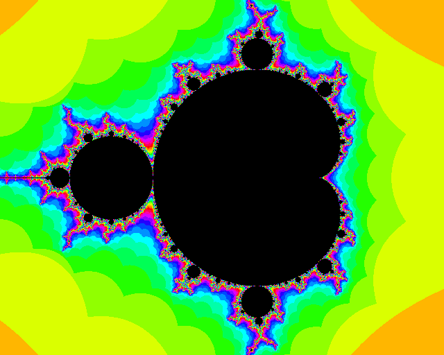
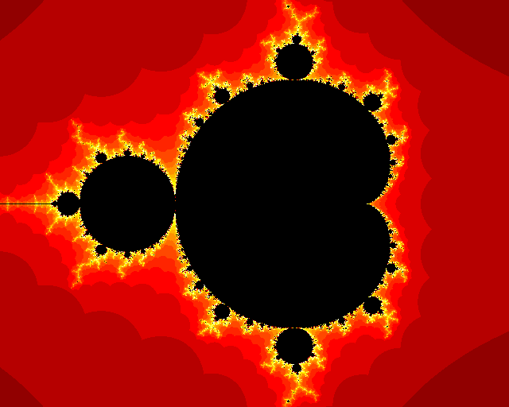
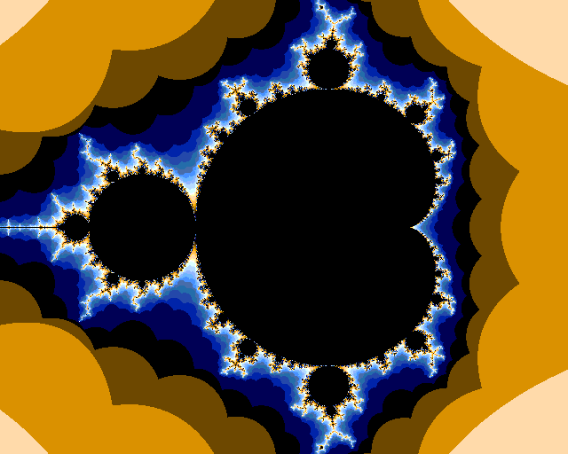
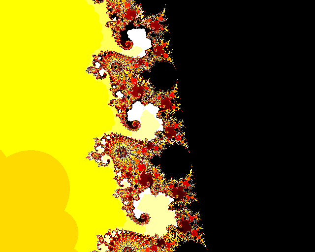
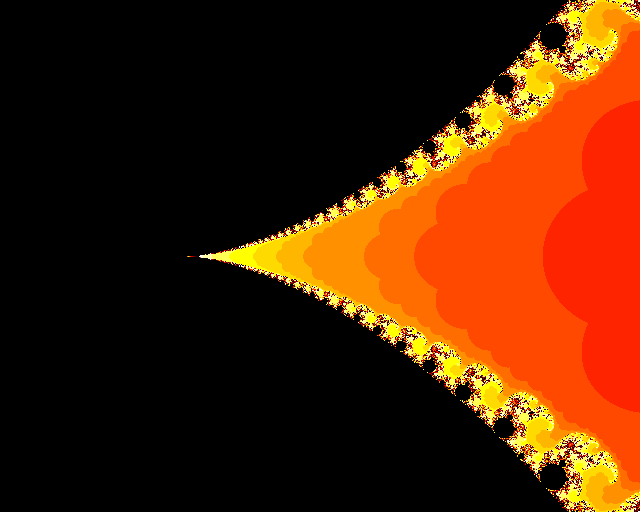
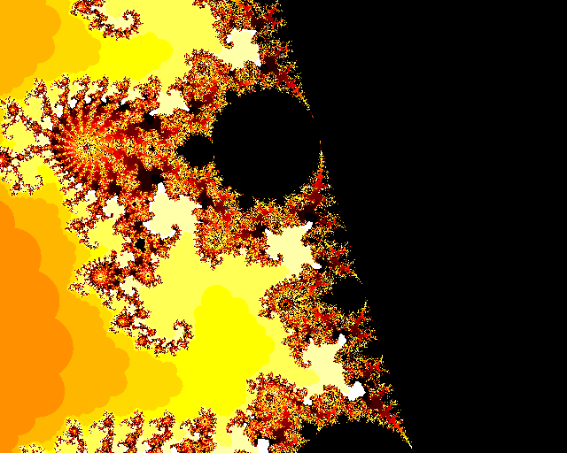
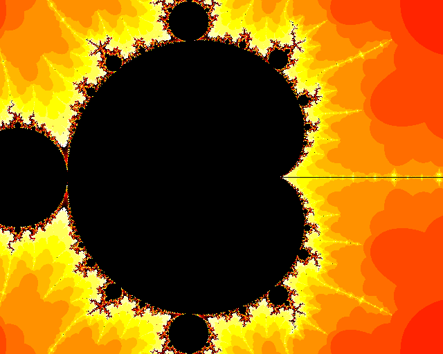

# Mandelbrot on the MEGA65
This draws the [Mandelbrot set](https://en.wikipedia.org/wiki/Mandelbrot_set)
in VHDL on the [MEGA65](https://mega65.org/) (board revisions R3 and R6),
which has a Xilinx Artix-7 XC7A200T FPGA. The picture (1280x1024) is shown on
the VGA and the HDMI output, and you can pan and zoom using a joystick or the
keyboard. The same design also runs on the
[Nexys 4 DDR](https://digilent.com/reference/programmable-logic/nexys-4-ddr/start)
board, which has a smaller FPGA (XC7A100T), and shows the picture in 640x480,
see [Nexys 4 DDR](#nexys-4-ddr).

736 of the 740 DSPs of the FPGA are used in parallel for the calculation, and
the picture is stored in block RAM. Generating a complete picture takes about
2.53 ms (about 396 pictures per second; 402 were measured on an R3 with the
main clock at 144 MHz), with the main clock at 141.64 MHz. On the Nexys 4 DDR,
with 240 DSPs and the main clock at 120 MHz, it takes about 1.2 ms (832 to 834
pictures per second, measured on the board), for a picture with less than a
quarter of the pixels.

## The algorithm
For each pixel, which corresponds to a complex number $c$, we iterate
$z \mapsto z^2 + c$ starting from $z = 0$, and count the number of iterations
until the real or the imaginary part of $z$ leaves the range -2 to 2 (the range
of the number format), up to a maximum of 511. This count decides the colour
of the pixel, using one of four colour palettes (selected with the keys `1`
to `4` on the MEGA65, see [Controls](#controls)). The points in the set (count 511) have
their own colour, and the other counts use all 9 bits of the count (palette 1 only the lower 8 bits).

The numbers are 18-bit
[fixed point](https://en.wikipedia.org/wiki/Fixed-point_arithmetic) (2 integer
bits and 16 fractional bits), and each iteration needs only two real
multiplications, using the identity $x^2 - y^2 = (x+y)(x-y)$. Each of the 368
job modules (120 on the Nexys 4 DDR) contains an iterator with two DSP
multipliers, one for each multiplication, and the iterator calculates one
iteration in every clock cycle. Most points in the set are found long before
the maximum count, because the values of $z$ start to repeat exactly
(periodicity detection). The picture is divided into jobs, each of 64 rows of
a picture column (120 on the Nexys 4 DDR), and the dispatcher gives the next
job to a job module as soon as it is idle.

The display memory has 1280x1024 pixels in 320 BRAMs (of the 365 in the
XC7A200T), with 21 bits of address (the column and the row). The job modules
write four pixels (consecutive rows of a picture column) to the display
memory at a time. The display memory takes one write per clock cycle, so with
one pixel in each write the picture would take at least 1280x1024 clock
cycles (9.25 ms), whatever the number of job modules. With four pixels in
each write the picture takes about 2.53 ms, i.e. about 396 pictures per
second (the model; an R3 showed 402 with the main clock at 144 MHz, the same
as the model), close to the limit of the display memory (2.31 ms). If every
pixel needed the maximum count, it would take 13.2 ms (75 pictures per
second), still above the 60 Hz of the VGA output, see
[MEGA65](ALGORITHM.md#mega65).

[ALGORITHM.md](ALGORITHM.md) explains the design in detail: the number format,
the multiplier, the iterator (including how overflow is detected), the jobs,
the dispatcher, and the timing and resource usage. [HISTORY.md](HISTORY.md)
has the history of the design: the earlier versions of its parts, and the
results of the earlier builds. The design was first developed in the
`mandelbrot/` folder of [MJoergen/nexys4ddr](https://github.com/MJoergen/nexys4ddr).

## Controls
A new picture is only calculated when the view changes, and after reset. In
between, the job modules are idle, and the FPGA uses much less power (see
[Redraw](ALGORITHM.md#redraw)). The view is controlled with a
joystick in each port, or with the keyboard, see
[`src/main/controls.vhd`](src/main/controls.vhd).

| Control | Description
| ------- | -----------
| Joystick port 1: left, right, up, down, or the cursor keys | Pan the picture left, right, up, and down, by 1/320 of the width of the picture (4 pixels) for each update. Panning stops at the edge of the number range (-2 to 2).
| Joystick port 1: fire, or the `+` key | Zoom in. The centre of the picture stays fixed. Zooming in stops at the smallest pixel size (2^-16).
| Joystick port 2: fire, or the `-` key | Zoom out. The centre of the picture stays fixed, except when zooming out would move an edge of the view beyond -2 or 2; then the view is moved instead. Zooming out stops when the view can not get larger.
| The keys `1`, `2`, `3`, and `4` | Select the colour palette 1, 2, 3, or 4 (see below). The palette stays selected when the key is released. If several of these keys are held down, the lowest one wins.
| Reset button | Resets the design and returns to the initial view. On the R3 the reset button is read by the MAX10 (a small FPGA on the board), which sends it to the XC7A200T over a serial link.

While a control is held down, the view is updated about 18 times per second.
Each update pans by 1/320 of the width (about 5.6% per second), or changes the
size of a pixel by about 1.6% (roughly 33% per second). The initial view
shows the real axis from -1.67 to 1 and the imaginary axis from -1.07 to
1.07. See [View control](ALGORITHM.md#view-control) for details.

The colour palettes are:
* 1: the lower 8 bits of the count are the colour (RRRGGGBB), mostly blue and
  green, and the set is white.
* 2: rainbow, the hue goes around the colour circle every 16 counts.
* 3 (fire, the palette after power-on): black, red, orange, yellow, and white,
  with the square root of the count.
* 4: blue, white, orange, and dark brown, with the logarithm of the count.

In the palettes 2 to 4 the set is black. See
[Colours](ALGORITHM.md#colours) for details. The reset button does not change
the palette.

The initial view in the palettes 1 to 4 (calculated by the bit-accurate model,
at half the resolution of the MEGA65, with `sim/palette_images.py`):

| | |
| --- | --- |
|  |  |
|  |  |

More pictures, in the fire palette (palette 3): the seahorse valley, the
elephant valley, a spiral, and a small copy of the whole set (the minibrot on
the real axis near -1.755):

| | |
| --- | --- |
|  |  |
|  |  |

The top left corner of the picture shows the view, in white on black: the
centre of the picture as a complex number, with five digits after the point,
and the zoom, which is 1.00 for the initial view, e.g.
`-0.33855-0.00417i   1.00x`. The zoom is the initial size of a pixel divided
by the current one, so it goes from 0.67 (zoomed out as far as possible) to
136.00 (zoomed in as far as possible, 273.00 on the Nexys 4 DDR). The rows go
down the screen, so the imaginary part increases downwards.

The frame rate, i.e. the number of pictures the design could calculate per
second, rounded down to an integer, is shown in the top right corner of the
picture. It is the clock frequency divided by the time taken by the latest
picture (the one on the screen). The view and the frame rate are both those of
the latest picture, and they are updated after every picture.

## Video output
The picture is 1280x1024 at 60 Hz, with a pixel clock of 108 MHz. It is
shown on the VGA connector (through the video DAC of the MEGA65), and on the
HDMI connector, in DVI mode (without audio), because 1280x1024 is not a
CEA-861 video mode. Most monitors accept 1280x1024; a widescreen monitor shows
it with black bars or stretched. The aspect ratio is 5:4, so the initial view
shows a little more of the imaginary axis (-1.07 to 1.07) than the 4:3
picture of the Nexys 4 DDR (-1 to 1).

## Board revisions
The board revisions R3 and R6 have the same FPGA, and the design is the
same, but some of the pins are different, so each revision has its own top
level module and bit-file (`make mega65-r3` and `make mega65-r6`), and the
bit-file of one revision must not be used on the other one. The R6 can pull
each joystick line low from the FPGA, and the design for the R6 must switch
this off, otherwise the joystick lines can be read as pressed, see
[`src/mega65_r6.vhd`](src/mega65_r6.vhd). The R3 does not have these
outputs, and the pins are used for other things. On the R3 the reset button
is not connected to the XC7A200T, but to the MAX10, and the design for the
R3 reads it from the MAX10 over a serial link, see
[`src/mega65_r3.vhd`](src/mega65_r3.vhd).

## Nexys 4 DDR
The same design also runs on the Nexys 4 DDR, which has a Xilinx Artix-7
XC7A100T FPGA (speed grade -1). The design was first developed on this board,
and the MEGA65 was added later. Only the size of the design, the
resolution, and the ports are different, see
[`src/nexys4ddr.vhd`](src/nexys4ddr.vhd):
* The picture is 640x480 at 60 Hz (with a pixel clock of 25 MHz), on the VGA
  output. The board has no HDMI output.
* There are 120 job modules (all 240 DSPs), with jobs of 120 rows, and the
  main clock is 120 MHz, because the iterators are slower in speed grade -1.
* The display memory has 2^19 pixels in 128 BRAMs (of the 135 in the
  XC7A100T), with 19 bits of address. The picture uses 80 of them.
* The view is controlled with the buttons, and the colour palette is selected
  with the switches.
* The frame rate is also shown on the 7-segment display.

The switch numbers are the bit numbers of the switch input, i.e. `SW0` to
`SW7` on the board.

| Control | Description
| ------- | -----------
| `BTNL`, `BTNR`, `BTNU`, `BTND` | Pan the picture left, right, up, and down, like joystick port 1, by 1/320 of the width of the picture (2 pixels) for each update.
| `BTNC` | Zoom in, like the fire button of joystick port 1. With switch 2 on, zoom out instead, like the fire button of joystick port 2.
| Switches 0 and 1 | Select the colour palette (switch 1 is the high bit). 1 (both off): the lower 8 bits of the count are the colour (RRRGGGBB), mostly blue and green, and the set is white. 2: rainbow, the hue goes around the colour circle every 16 counts. 3: fire, black, red, orange, yellow, and white, with the square root of the count. 4: blue, white, orange, and dark brown, with the logarithm of the count. In the palettes 2 to 4 the set is black.
| Switches 3 to 7 | Not used.
| `CPU RESET` | Resets the design and returns to the initial view.

The 7-segment display shows the same frame rate as the top right corner of
the VGA output.

## Implementation results
The design is built with Vivado 2025.1. The timing of the longest path (in
the iterators) is very close, and the setup slack varies by about 0.1 ns
between runs, see below.

The resource usage is:

| Resource           | MEGA65 (XC7A200T-2) | Available | Nexys 4 DDR (XC7A100T-1) | Available
| ------------------ | ------------------- | --------- | ------------------------ | ---------
| DSP48E1            | 736 (99%)           | 740       | 240 (100%)               | 240
| Block RAM (RAMB36) | 321 (88%)           | 365       | 128.5 (95%)              | 135
| Slices             | 22,391 (67%)        | 33,650    | 9,352 (59%)              | 15,850
| LUTs               | 48,336 (36%)        | 134,600   | 16,859 (27%)             | 63,400
| Registers          | 60,887 (23%)        | 269,200   | 27,276 (22%)             | 126,800

The performance and timing are:

|                 | MEGA65                                   | Nexys 4 DDR
| --------------- | ---------------------------------------- | ------------------
| Resolution      | 1280x1024                                | 640x480
| Clock frequency | 141.64 MHz                               | 120.00 MHz
| Initial FPS     | 396 (estimated; 402 measured at 144 MHz) | 832-834 (measured)
| Worst-case FPS  | 75 (estimated)                           | 87 (estimated)
| Setup slack     | +0.041 ns                                | +0.051 ns
| Hold slack      | +0.025 ns                                | +0.006 ns

The numbers for the MEGA65 are from the build for the R6. The build for the
R3 met timing with +0.070 ns (22,347 slices, +0.025 ns hold slack). The
builds before the palettes used all 9 bits of the count had +0.086 ns on the
R6 (22,151 slices, 48,267 LUTs), +0.066 ns on the R3, and +0.004 ns on the
Nexys 4 DDR (16,815 LUTs). The builds before them, before the view was shown in the top left corner, the
palette was selected with the keys `1` to `4`, and the R3 read the reset
button from the MAX10, met timing with +0.070 ns on the R6 (21,814 slices),
+0.033 ns on the R3, and +0.037 ns on the Nexys 4 DDR (10,217 slices). At
144 MHz the R3 had failed
timing by 0.076 ns, so the main clock was reduced to 141.64 MHz, which gives
0.116 ns more setup slack. See
[Resources and timing closure](ALGORITHM.md#resources-and-timing-closure)
for details, and [HISTORY.md](HISTORY.md#builds-of-the-mega65) for the
earlier builds.

## Running
Type `make` to list the supported targets. The most important ones are
(the versions of the tools are in [Tools](#tools)):
* `make mega65-r6` synthesizes and implements the design for the MEGA65 R6
  using
  [Vivado](https://www.amd.com/en/products/software/adaptive-socs-and-fpgas/vivado.html),
  and generates `build/mega65-r6/mega65-r6.bit`. It expects Vivado in
  `/opt/Xilinx/2025.1/Vivado` (the variable `XILINX_DIR`). It takes about 13
  minutes, see [MEGA65](ALGORITHM.md#mega65). Vivado is run in
  `build/mega65-r6/`, so the log (`vivado.log`), the routed checkpoint
  (`mega65-r6.dcp`), the reports of the routed design (`timing.rpt`,
  `utilization.rpt`, and `power.rpt`), and the other files from Vivado are
  there too. The bit-file is only written when the design meets timing:
  otherwise the build deletes any old bit-file and stops with an error (the
  checkpoint and the reports are still written). The build also stops after
  synthesis if it does not find two DSPs for each iterator, because then the
  DSPs of the iterators are not placed next to each other, see
  [Iterator](ALGORITHM.md#iterator).
* `make mega65-r3` does the same for the MEGA65 R3, in `build/mega65-r3/`, and
  generates `build/mega65-r3/mega65-r3.bit`. Use the bit-file of your board
  revision, see [Board revisions](#board-revisions).
* `make nexys4ddr` does the same for the Nexys 4 DDR, in `build/nexys4ddr/`,
  and generates `build/nexys4ddr/nexys4ddr.bit`. It takes about 6 minutes.
  Because each board has its own directory, they can all be built at the same
  time with `make -j3 mega65-r3 mega65-r6 nexys4ddr`.
* `make fpga BOARD=mega65-r6` programs the FPGA of the board with its
  bit-file, here `build/mega65-r6/mega65-r6.bit` (which is built first, if
  needed), using `m65 -q <bit-file>`. It works the same for `mega65-r3` and
  `nexys4ddr`. Without `BOARD` it lists the boards. The `m65` tool is from the
  [mega65-tools](https://github.com/MEGA65/mega65-tools) repository, and must
  be in the `PATH` (or set the variable `M65`).
* `make cor` makes the core files of the MEGA65 boards,
  `build/mega65-r3/mega65-r3.cor` and `build/mega65-r6/mega65-r6.cor`, from
  their bit-files (which are built first, if needed), using `coretool`. A core
  file is flashed into a slot with MEGAFLASH (hold No Scroll while switching
  on the MEGA65), so the design starts without a JTAG cable. MEGAFLASH shows
  the name `Mandelbrot` and the version, which is the commit
  (`git describe --always --dirty`, e.g. `c1e432c`); set `COR_NAME` or
  `COR_VERSION` to change them. The core file also holds the board revision
  (`mega65r3` or `mega65r6`); flash the one of your board revision, see
  [Board revisions](#board-revisions). The
  `coretool` is the Python script `src/tools/coretool` of the
  [mega65-tools](https://github.com/MEGA65/mega65-tools) repository, and must
  be in the `PATH` (or set the variable `CORETOOL`, e.g.
  `make cor CORETOOL=~/mega65-tools/src/tools/coretool`).
* `make sim` runs all the testbenches in parallel, without opening the
  waveform viewer, see [below](#simulation). This requires
  [GHDL](https://github.com/ghdl/ghdl). It uses one job per CPU (set
  `SIM_JOBS` to change that), writes the output of each testbench to
  `build/<name>.log`, and ends with a pass/fail summary. It takes about 9
  minutes, almost all of which is the `vga` testbench (because of 1280x1024).
* `make run TB=iterator` runs a single testbench. It does not write a
  waveform, because that makes the simulation much slower. Without `TB` it
  lists the available testbenches. It has the same requirements as
  `make sim`.
* `make check TB=iterator` runs a single testbench like `make run`, but also
  writes the waveform to `sim/iterator.ghw`, and then shows it in
  [GTKWave](https://github.com/gtkwave/gtkwave).
* `make formal` runs the formal verification, see
  [below](#formal-verification). This requires
  [SymbiYosys](https://github.com/YosysHQ/sby), Yosys with the
  [GHDL plugin](https://github.com/ghdl/ghdl-yosys-plugin), and an SMT solver
  (Yices), e.g. from the [OSS CAD Suite](https://github.com/YosysHQ/oss-cad-suite-build).
  It takes about 20 seconds.
* `make diagrams` renders the block diagrams and the timing diagrams
  (`doc/*.tex`, TikZ) to PNG files next to them, which the documentation
  links to. The PNG files are
  in the repository, so this is only needed after changing a diagram. It
  requires `pdflatex` and `pdftoppm`.
* `make clean` removes the generated files.

## Tools
These versions of the tools are known to work. Older versions have not been
tried, except where it says so.

| Tool | Version | Used by
| ---- | ------- | -------
| [Vivado](https://www.amd.com/en/products/software/adaptive-socs-and-fpgas/vivado.html) | 2025.1 | `make mega65-r3`, `make mega65-r6`, `make nexys4ddr`
| [GHDL](https://github.com/ghdl/ghdl) | 6.0.0 (mcode backend, the release for Ubuntu 24.04), 6.0.0-dev (mcode, built from source in February 2026), and 4.1.0 (mcode, the package in Ubuntu 24.04) | `make sim`, `make run`, `make check`
| [Yosys](https://github.com/YosysHQ/yosys), [SymbiYosys](https://github.com/YosysHQ/sby) | 0.56, and 0.69 (in the [OSS CAD Suite](https://github.com/YosysHQ/oss-cad-suite-build) of 2026-10-01) | `make formal`
| [ghdl-yosys-plugin](https://github.com/ghdl/ghdl-yosys-plugin) | from git (May 2025), built with GHDL 6.0.0-dev, and the one in the OSS CAD Suite of 2026-10-01 | `make formal`
| [Yices](https://yices.csl.sri.com/) | 2.7.0 | `make formal`
| [VSG](https://vhdl-style-guide.readthedocs.io/) | 3.35.0 | the coding style, see [`CODING_STYLE.md`](CODING_STYLE.md)
| Python, numpy | 3.12, numpy 2.5 | `sim/model.py`, `sim/cmp_rtl.py`, `sim/iterator_model.py`
| [GTKWave](https://github.com/gtkwave/gtkwave) | 3.3.116 | `make check`
| [m65](https://github.com/MEGA65/mega65-tools) | 20251108 | `make fpga`
| [coretool](https://github.com/MEGA65/mega65-tools) | from git (commit 44c63d2, 2026-10-05), Python 3.12 | `make cor`
| pdflatex (TeX Live, with TikZ and tikz-timing), pdftoppm (Poppler) | TeX Live 2023, Poppler 24.02 | `make diagrams`

The testbenches use external names of VHDL-2008 (`disp_mem_tb`,
`iterator_tb`, and `redraw_tb`). GHDL 4.1 crashes on an external name inside
a generate statement, and gets the bounds of its subtype wrong when they are
not numbers, so `disp_mem_tb` gives each configuration its own process, see
the comments there. The GHDL of the OSS CAD Suite of 2026-10-01 (7.0.0-dev,
with the LLVM backend) stops with "NULL access dereferenced" at every
external name, so these three testbenches fail with it (the others pass, and
so does `make formal`). The Makefile uses the `ghdl` in the `PATH`; another
one is selected with e.g. `make sim GHDL=/opt/ghdl-4.1/bin/ghdl`.

The script [`scripts/install-tools.sh`](scripts/install-tools.sh) installs
the free tools in `~/.cache/mandelbrot-tools` (or another directory given as
its argument), and prints the directories to add to the `PATH`: the OSS CAD
Suite of 2026-10-01 for `make formal`, the GHDL 6.0.0 release (mcode) for
`make sim`, and VSG 3.35.0 and numpy in a Python virtual environment. The
first run downloads about 770 MB. Vivado is not free to download, so it is
not installed.

**Continuous integration.** On every push and pull request,
[GitHub Actions](.github/workflows/ci.yml) installs the tools with this
script, and runs `make formal`, VSG, `make consts`, and `make sim` (about
10 minutes in all). The builds for the boards need Vivado, so they are not run there. The
logs of the simulation and of the formal verification are kept with the run.

**Claude Code.** The cloud environment of Claude Code has none of the tools,
so the project settings ([`.claude/settings.json`](.claude/settings.json))
run [`scripts/claude-session-start.sh`](scripts/claude-session-start.sh)
when a session starts. In the cloud environment it installs the free tools
with the script above, and adds them to the `PATH` of the session; elsewhere
it does nothing.

## Simulation
There are testbenches in [`sim/`](sim) for `dispatcher`, `job`, `iterator`,
`job_scheduler`, `res_scheduler`, `viewport`, `vga`, `overlay`, `disp_mem`,
`fps`, `view_text`, `cdc_data`, and `controls`, and two for `main`: `redraw` checks that it
only calculates a picture when the view changes, and that the pictures end up
in the display memory, and `picture` compares every pixel of three small
pictures (64x48) with the bit-accurate model.
All of them are self-checking, and stop with an error if the result is wrong.
They stop by themselves when they are finished, and report
`<name>_tb: finished`. `make sim` only counts a testbench as passed when it
has reported this, so a testbench that hangs (and runs until the `STOP_TIME`
of the Makefile, 6 ms) fails, although GHDL then exits without an error.

There is also a testbench for `main`, which is not part of `make sim`, because
it is slow. It writes the calculated picture to a file, which is compared
bit-accurately with a Python model of the design by the script `cmp_rtl.py`.
This requires Python with numpy. A partial picture of the MEGA65 (about 79000
pixels) takes about 14 minutes:
```
make run TB=main STOP_TIME=200us
sim/cmp_rtl.py
```
The design of the Nexys 4 DDR is simulated by setting the generics of the
testbench, where the same simulated time gives about 50000 pixels in about
5 minutes:
```
make run TB=main STOP_TIME=200us GENERICS="G_NUM_ITERATORS=120 G_PIXELS=4 G_ROWS_IN_JOB=120 G_NUM_COLS=640 G_NUM_ROWS=480 G_COL_STRIDE=512 G_ADDR_BITS=19"
sim/cmp_rtl.py
```
See [Iterator](ALGORITHM.md#iterator) for details. `make consts` checks that
the constants of the boards in the model and in the defaults of `main_tb` are
the same as in the design.

The simulation does not need any Xilinx libraries. The DSPs in the iterators
are inferred by Vivado from plain VHDL, see [Multiplier](ALGORITHM.md#multiplier).

The clock and reset module (`src/clk_rst.vhd`) uses Xilinx primitives (the
MMCM and the clock buffers), and so does the design of the MEGA65
(`src/mega65.vhd`: the clock of the video DAC, and the serialisers of the
HDMI output). They are not simulated, and neither are the top levels
(`src/mega65_r3.vhd`, `src/mega65_r6.vhd`, and `src/nexys4ddr.vhd`), which
instantiate them. So the logic of the designs of the boards is kept in
entities of their own, which are simulated: the clock domain crossing of the
frame rate (`src/cdc_data.vhd`), and the mapping of the joysticks and the keys
of the MEGA65 (`src/main/controls.vhd`). What is left in `src/mega65.vhd` is
the expansion of the colour to 8 bits, the registers of the video DAC, and
the sync signals for the HDMI output, which are only checked on the board.

## Formal verification
There are formal proofs in [`formal/`](formal) for `res_scheduler`,
`job_scheduler`, `job`, `dispatcher_jobs`, and `dispatcher_results`. The
properties of each module are in a PSL file
(`<name>.psl`), which is bound to the module, so the modules themselves are not
changed. Each module is proved for a few sets of generics (see `<name>.sby`),
with k-induction, and cover statements check that the interesting cases are
reachable. The properties are:
* `res_scheduler`: Only a process that is ready is selected, and only while
  the scheduler is active. Each result is selected only once. A process that
  stays ready is selected within a bounded time, also when all the processes
  are ready (the order is fair), and the bound is reached.
* `job_scheduler`: Only an idle process is started, and only while the
  scheduler is active. The processes are visited in order, and an idle
  process is always started when it is visited, so it is started within
  `G_SIZE`+1 clock cycles.
* `job`: The job module is busy from the start of a job until its last result
  is acknowledged. The results come in order, one for each group of
  `G_PIXELS` rows, with the row number of the first row. A result stays
  unchanged until it is acknowledged, and is then removed. Each result has the
  counts of its rows from the iterator. The iterator is started once for each
  row, with the value of c of that row, and c does not change while it
  iterates.
* `dispatcher_jobs` (with `job_scheduler`): The jobs of a picture are given
  out in order, one block at a time, each once. The job module given a job is
  started in the next clock cycle, with the value of c of the first row of
  the job. The picture is done only when all its jobs have been given out and
  all the job modules are idle, and then within two clock cycles. It also
  meets the assumptions about the inputs of the job module in `job.psl`: a job
  module is only started when it is idle (this needs at least five job
  modules; with four, a job is started twice), not right after its reset, and
  the step in cy does not change while it is busy. The job modules are not
  included; their busy flags are given by assumptions. A new picture must
  only be started when the previous one is done, as `main` does.
* `dispatcher_results` (with `res_scheduler`): At most one job module is
  acknowledged in each clock cycle, and only one that has a result. Each
  acknowledged result is written exactly once, two clock cycles after the
  acknowledge, to the address from the table of the jobs (the picture column
  and the block) and the row of the result, with the counts of the result,
  and nothing else is written. When a job module is selected by
  `res_scheduler` in clock cycle c, its ready flag is low from c+2, as
  `res_scheduler` requires. The job modules and `dispatcher_jobs` are not
  included; their results and the table of the jobs are given by
  assumptions (as `job.psl` and `dispatcher_jobs.psl` prove them). Only the
  reset at the start is covered: a reset during a picture also resets the
  job modules, which then lose their results without an acknowledge.

For `job`, the iterator is replaced by a stub
([`formal/iterator_stub.vhd`](formal/iterator_stub.vhd)) whose outputs are
chosen freely by the solver. Its handshake (done goes low after a start, goes
high after any number of clock cycles, and then stays high with an unchanged
count until the next start) is given by assumptions in `job.psl`. So the count
of each row can be any value, and the iteration can take any number of clock
cycles. The iterator itself is checked by simulation, see above.

## License
The design is licensed under the [MIT License](LICENSE), except for the files
copied from other projects, which keep their own licenses:
* [`src/keyboard/`](src/keyboard): the MEGA65 keyboard driver, from the
  [MiSTer2MEGA65](https://github.com/sy2002/MiSTer2MEGA65) framework (via
  [C64MEGA65](https://github.com/MJoergen/C64MEGA65)), originally by Paul
  Gardner-Stephen, GPL v3.
* [`src/hdmi/`](src/hdmi): the HDMI output, from The Tyto Project by Adam
  Barnes (via C64MEGA65), LGPL v3.
* [`src/max10/`](src/max10): the serial link to the MAX10 of the MEGA65 R3,
  from the [MEGA65 core](https://github.com/MEGA65/mega65-core) by Paul
  Gardner-Stephen (via C64MEGA65), GPL v3.
* [`src/vga/font_pkg.vhd`](src/vga/font_pkg.vhd): the digits of the
  [Spleen](https://github.com/fcambus/spleen) font by Frederic Cambus, BSD
  2-Clause (see [`font/LICENSE.spleen`](font/LICENSE.spleen), and the header
  of the file).

The keyboard driver and the HDMI output are only used on the MEGA65, so a
bit-file for the MEGA65 includes them, and one for the Nexys 4 DDR does not.
The link to the MAX10 is only used on the MEGA65 R3.
`src/clk_rst.vhd` started as the output of the Xilinx Clocking Wizard, but
has been rewritten by hand.

## Files
The files used only in the MAIN clock domain are in [`src/main/`](src/main),
and those used only in the VGA clock domain are in [`src/vga/`](src/vga). The
files that are in both clock domains are in [`src/`](src), and the files from
other projects that only the MEGA65 uses are in [`src/keyboard/`](src/keyboard),
[`src/hdmi/`](src/hdmi), and [`src/max10/`](src/max10).

| File             | Description
| ---------------- | -----------
| [`src/mega65_r3.vhd`](src/mega65_r3.vhd), [`src/mega65_r6.vhd`](src/mega65_r6.vhd) | Top levels for the MEGA65 R3 and R6. They connect `mega65.vhd` to the pins of each board revision. The R6 also switches off the outputs that pull the joystick lines low, and switches on the power of the joysticks and of the video DAC. Both switch on the level shifter of the HDMI output, whose pins are different on the two revisions. The R3 reads the reset button from the MAX10, with `max10`.
| [`src/mega65.vhd`](src/mega65.vhd) | The design for the MEGA65, used by the two top levels above. Instantiates the clock and reset generation, the display memory, the two modules for the clock domains below, and `cdc_data`. Also reads the joysticks and the keyboard (with `controls`), and drives the video DAC and the HDMI output.
| [`src/cdc_data.vhd`](src/cdc_data.vhd) | A generic clock domain crossing for a value that changes seldom. Used by the designs of both boards to move the frame rate and the view from the MAIN clock domain to the VGA clock domain.
| [`src/main/controls.vhd`](src/main/controls.vhd) | Maps the joysticks and the keys of the MEGA65 to the buttons and switches of `main`, i.e. the controls of the view, and the palette (keys `1` to `4`).
| [`src/keyboard/`](src/keyboard) | MEGA65 keyboard driver, from the [MiSTer2MEGA65](https://github.com/sy2002/MiSTer2MEGA65) framework (via [C64MEGA65](https://github.com/MJoergen/C64MEGA65), GPL v3). `m2m_keyb` reads the keyboard, and cycles through the keys, showing whether each of them is pressed. Only used by `mega65.vhd`.
| [`src/hdmi/`](src/hdmi) | HDMI output, from The Tyto Project by Adam Barnes (via [C64MEGA65](https://github.com/MJoergen/C64MEGA65), LGPL v3). `vga_to_hdmi` encodes the picture to TMDS symbols (in DVI mode), and `serialiser_10to1_selectio` outputs them on the pins. Only used by `mega65.vhd`.
| [`src/max10/`](src/max10) | Serial link to the MAX10 of the MEGA65 R3, from the [MEGA65 core](https://github.com/MEGA65/mega65-core) by Paul Gardner-Stephen (via [C64MEGA65](https://github.com/MJoergen/C64MEGA65), GPL v3). `max10` sends a 25 MHz clock to the MAX10, and reads the reset button (and other signals, which are not used) from it. Only used by `mega65_r3.vhd`.
| [`src/nexys4ddr.vhd`](src/nexys4ddr.vhd) | Top level for the Nexys 4 DDR. The same as `mega65.vhd`, but with the ports of the Nexys 4 DDR (mapped directly to pins on the FPGA), fewer job modules, a smaller display memory, a resolution of 640x480, and no HDMI output.
| [`src/main/main.vhd`](src/main/main.vhd) | Everything in the MAIN clock domain: view control from the buttons and switches (which the MEGA65 takes from the joysticks and the keyboard), the dispatcher, the view as text (shown on the VGA output), and the frame rate (shown on the VGA output, and on the 7-segment display of the Nexys 4 DDR).
| [`src/main/viewport.vhd`](src/main/viewport.vhd) | View control. Pans and zooms the view, and keeps it inside the range of the number format.
| [`src/main/fps.vhd`](src/main/fps.vhd), [`src/main/seg.vhd`](src/main/seg.vhd) | Frame rate. `fps` divides the clock frequency by the time taken by the latest picture, and converts the result to decimal, and `seg` multiplexes the digits on the 7-segment display of the Nexys 4 DDR.
| [`src/main/view_text.vhd`](src/main/view_text.vhd) | Converts the view to the text shown in the top left corner: the centre of the picture and the zoom, in decimal.
| [`src/vga/vga.vhd`](src/vga/vga.vhd) | Everything in the VGA clock domain: pixel counters, VGA output, and the overlay of the view and the frame rate.
| [`src/main/iterator.vhd`](src/main/iterator.vhd) | Iterates the Mandelbrot function for a single point, one iteration in each clock cycle, using two DSPs.
| [`src/main/job.vhd`](src/main/job.vhd) | A job module. Calculates one job (64 rows of a picture column, or 120 on the Nexys 4 DDR) at a time, using one iterator.
| [`src/main/dispatcher.vhd`](src/main/dispatcher.vhd) | Controls the calculation of the entire picture: hands out the jobs to the idle job modules, and collects the results. Instantiates the job modules, between its two parts below.
| [`src/main/dispatcher_jobs.vhd`](src/main/dispatcher_jobs.vhd) | First part of the dispatcher: hands out the jobs to the idle job modules, and finds out when the picture is done.
| [`src/main/dispatcher_results.vhd`](src/main/dispatcher_results.vhd) | Second part of the dispatcher: collects the results, and writes them to the display memory.
| [`src/main/dispatcher_pkg.vhd`](src/main/dispatcher_pkg.vhd) | Types used in the ports of the two parts of the dispatcher.
| [`src/main/job_scheduler.vhd`](src/main/job_scheduler.vhd) | Round-robin scheduler. Used by dispatcher\_jobs to give jobs to idle job modules.
| [`src/main/res_scheduler.vhd`](src/main/res_scheduler.vhd) | Scheduler for the results. Used by dispatcher\_results to pick which job module's result to accept, from the job modules that have a result ready.
| [`src/disp_mem.vhd`](src/disp_mem.vhd) | Display memory, holding the picture, in blocks of 4096 pixels (one BRAM each): 320 on the MEGA65, and 128 on the Nexys 4 DDR.
| [`src/vga/pix.vhd`](src/vga/pix.vhd), [`src/vga/disp.vhd`](src/vga/disp.vhd) | VGA output. `pix` generates the pixel counters, and `disp` generates the sync signals and the pixel colour.
| [`src/vga/video_pkg.vhd`](src/vga/video_pkg.vhd) | The video modes, i.e. the resolution and the timing of the VGA output: 1280x1024 (MEGA65) and 640x480 (Nexys 4 DDR), both at 60 Hz.
| [`src/vga/palette_pkg.vhd`](src/vga/palette_pkg.vhd) | The four colour palettes, which convert the count of a pixel to its colour.
| [`src/vga/overlay.vhd`](src/vga/overlay.vhd), [`src/vga/font_pkg.vhd`](src/vga/font_pkg.vhd), [`src/text_pkg.vhd`](src/text_pkg.vhd) | Overlay of the view and the frame rate. `overlay` shows a line of text at the top of the picture (the view on the left, and the frame rate on the right), with the font in `font_pkg`. `text_pkg` defines the characters (the digits and `.-+ix`).
| [`font/`](font) | The script that generates `font_pkg.vhd` from the [Spleen](https://github.com/fcambus/spleen) 16x32 font, and the license of the font (BSD 2-Clause, see [`font/LICENSE.spleen`](font/LICENSE.spleen)). The font itself (version 2.2.0) is not in this repository; the script says how to get it.
| [`src/util_pkg.vhd`](src/util_pkg.vhd) | The function `log2`, the number of bits needed for a range of values, used in both clock domains.
| [`src/clk_rst.vhd`](src/clk_rst.vhd) | Clock and reset generation: the main clock for the calculation (141.64 MHz, or 120 MHz on the Nexys 4 DDR), the pixel clock for VGA (108 MHz for 1280x1024, 25 MHz for 640x480), each with a synchronous reset, and the TMDS clock for the HDMI output of the MEGA65 (540 MHz).
| [`sim/`](sim) | Testbenches and [GTKWave](https://github.com/gtkwave/gtkwave) setups, a Python model of the iterator count (`iterator_model.py`), a vectorized model of the complete picture (`model.py`), the same bit-accurate model in VHDL (`iterator_model_pkg.vhd`, used by the testbenches), and a script (`cmp_rtl.py`) that compares the output of the testbench `main_tb` with this model.
| [`formal/`](formal) | Formal verification with [SymbiYosys](https://github.com/YosysHQ/sby): the properties of each module (`<name>.psl`), the tasks (`<name>.sby`), and the iterator stub used for `job`, see [Formal verification](#formal-verification).
| [`mega65-r3.xdc`](mega65-r3.xdc), [`mega65-r6.xdc`](mega65-r6.xdc), [`nexys4ddr.xdc`](nexys4ddr.xdc), [`mandelbrot.tcl`](mandelbrot.tcl) | Pin and timing constraints for each board, and script for synthesis and implementation with Vivado (including the optimization directives needed to meet timing), see [Running](#running). The script gets the FPGA part, the top level, and the list of source files from the Makefile, so it must be run through `make mega65-r3`, `make mega65-r6`, or `make nexys4ddr`.
| [`mandelbrot.xlsx`](mandelbrot.xlsx) | Spreadsheet used during the design. It iterates the example point -1+0.5i from [the iterator section](ALGORITHM.md#iterator) using real numbers.
| [`ALGORITHM.md`](ALGORITHM.md) | Detailed explanation of the algorithm and the design.
| [`doc/`](doc) | The block diagrams and the timing diagrams of ALGORITHM.md, as TikZ sources (`<name>.tex`) and the PNG files made from them by `make diagrams`.
| [`HISTORY.md`](HISTORY.md) | The history of the design: the earlier versions of its parts, the numbers of the model at the time, and the results of the earlier builds.
| [`CODING_STYLE.md`](CODING_STYLE.md), [`vsg.yml`](vsg.yml) | The VHDL coding style, and the configuration of [VSG](https://vhdl-style-guide.readthedocs.io/) that checks most of it.
| [`scripts/`](scripts), [`.github/workflows/ci.yml`](.github/workflows/ci.yml), [`.claude/settings.json`](.claude/settings.json) | Installation of the free tools, the continuous integration on GitHub, and the hook that installs the tools in the cloud environment of Claude Code, see [Tools](#tools).
| [`TODO.md`](TODO.md) | Ideas for further changes.
| [`LICENSE`](LICENSE) | The license of the design (MIT), see [License](#license).
